# Documentação Técnica e Arquitetural: CARRIN

> **Versão Atual:** `1.3.534` (Build `534`) — Outubro de 2026  
> **Status:** Produção Estável  
> **Slogan:** *"Sua lista, sem complicação."*

---

## 1. Visão Geral do Projeto

O **CARRIN** é um ecossistema mobile inteligente em Flutter para gestão financeira doméstica, compras de supermercado e economia colaborativa comunitária. O aplicativo une privacidade total com poder analítico:
1. **Privacidade Absoluta & Nuvem Pessoal:** Cada usuário sincroniza suas listas diretamente com sua própria planilha do **Google Sheets** via OAuth 2.0 (`UserSheetsService`), sem servidores intermediários ou acesso de terceiros aos seus dados pessoais.
2. **Arquitetura Offline-First (SQLite):** Todas as operações (adicionar, riscar, editar, excluir, calcular) funcionam instantaneamente sem internet com persistência em banco local e sincronização resiliente em fila (`sync_queue`).
3. **Radar de Preços & Comunidade (Supabase):** Rede colaborativa de preços em tempo real onde os produtos comprados alimentam a base comunitária, permitindo comparação de preços, identificação do mercado mais barato da região e cálculo de economia potencial via GPS.
4. **Geolocalização & Geofencing:** Identificação automática do supermercado em que o usuário está comprando (com referência calibrada para o **Supermercados Guanabara Niterói**).
5. **Scanner Duplo:** Leitor de código de barras para preenchimento de itens e leitor de cupom fiscal / NFC-e SEFAZ via QR Code com extração automatizada de produtos, quantidades e valores.

---

## 2. Mapa Completo do Aplicativo (App Sitemap)

### 2.1 Diagrama de Navegação e Fluxo de Telas (Mermaid)

```mermaid
flowchart TD
  Splash["SplashScreen<br/>(Abertura & Checagem de Sessão)"] --> Main["MainScreen<br/>(Navegação por 5 Abas no Rodapé)"]
  
  subgraph Rodape["Navegação Principal (Rodapé)"]
    Tab0["1. Início<br/>(DashboardScreen)"]
    Tab1["2. Carrinhos<br/>(MonthSelectionScreen)"]
    Tab2["3. Análises<br/>(StatisticsScreen)"]
    Tab3["4. Comunidade<br/>(CommunityRadarScreen)"]
    Tab4["5. Ajustes<br/>(SettingsScreen)"]
  end

  Main --> Tab0
  Main --> Tab1
  Main --> Tab2
  Main --> Tab3
  Main --> Tab4

  %% --- FLUXO DA ABA 1: INÍCIO ---
  Tab0 --> Accounts["AccountsScreen<br/>(Contas Online & Perfis Offline)"]
  Tab0 --> ScanQuick["BarcodeScannerScreen<br/>(Busca / Leitura Rápida)"]
  Tab0 --> QuickSum["QuickSummary<br/>(Métricas de Saldo & Orçamento)"]
  Tab0 --> MonthQuickNav["Navegação Direta<br/>(Abre Carrinho do Mês Ativo)"]

  %% --- FLUXO DA ABA 2: CARRINHOS ---
  Tab1 --> NewCart["Modal Novo Carrinho<br/>(Em Branco ou Usar Anterior)"]
  Tab1 --> ShoppingList["ShoppingListScreen<br/>(Lista de Compras Ativa)"]
  ShoppingList --> AddItem["Modal Adicionar/Editar Item"]
  ShoppingList --> BarcodeScan["BarcodeScannerScreen<br/>(Autofill por Histórico)"]
  ShoppingList --> ReceiptScan["ReceiptScannerScreen<br/>(NFC-e / Cupom SEFAZ QR Code)"]
  ShoppingList --> WeightCalc["WeightCalculatorDialog<br/>(Calculadora Preço/Kg)"]
  ShoppingList --> FloatCalc["FloatingCalculatorPopup<br/>(Calculadora Assistiva Flutuante)"]
  ShoppingList --> RateioDialog["RateioDialog<br/>(Divisão de Conta por Pessoa)"]
  ShoppingList --> FilterSheet["ShoppingFilterBottomSheet<br/>(Filtros, Categorias & Ordenação)"]
  ShoppingList --> MarketLock["MarketLockOverlay<br/>(Finalizar / Trancar Carrinho)"]
  ShoppingList --> MarketPurpose["MarketAndPurposeWidgets<br/>(Definir Mercado & Propósito)"]
  ShoppingList --> PdfExport["PdfExportDialog<br/>(Compartilhamento WhatsApp / PDF)"]

  %% --- FLUXO DA ABA 3: ANÁLISES ---
  Tab2 --> BuyerProfile["BuyerProfileScreen<br/>(Perfil de Comprador & Hábitos)"]
  Tab2 --> TimeFilter["Filtros Temporais<br/>(3 meses / 6 meses / 1 ano / Tudo)"]
  Tab2 --> CatBreakdown["Detalhamento por Categorias<br/>(Gráfico de Pizza & Barras FL Chart)"]

  %% --- FLUXO DA ABA 4: COMUNIDADE ---
  Tab3 --> ComList["Sub-Aba 1: Lista<br/>(Feed de Preços Recentes)"]
  Tab3 --> ComComp["Sub-Aba 2: Comparador<br/>(Menor Preço & Economia %)"]
  Tab3 --> ComRank["Sub-Aba 3: Mercados<br/>(Ranking de Menor Preço Médio)"]
  Tab3 --> GpsRadius["Seletor de Raio GPS<br/>(5 km, 10 km, 15 km, 30 km)"]
  Tab3 --> CollabPrice["Modal Colaborar Preço<br/>(Envio Manual)"]

  %% --- FLUXO DA ABA 5: AJUSTES ---
  Tab4 --> ThemeSheet["ThemeColorPickerSheet<br/>(Paleta de Cores do Tema)"]
  Tab4 --> IconSheet["Seletor de Ícones do App<br/>(Ícone Clássico vs Moderno)"]
  Tab4 --> AccessOpts["Acessibilidade<br/>(Modos Daltônicos & Escala de Fonte)"]
  Tab4 --> BackupOpt["Backup & Restauração<br/>(Exportar / Importar SQLite JSON)"]
  Tab4 --> TutorialNav["TutorialScreen<br/>(Tutorial Interativo Completo)"]
  Tab4 --> TermsNav["TermsScreen<br/>(Termos de Uso & Política LGPD)"]
```



### 2.2 Estrutura Detalhada de Rotas e Telas

| Tela / Rota | Arquivo Fonte | Responsabilidade Principal |
| :--- | :--- | :--- |
| **SplashScreen** | [`lib/screens/splash_screen.dart`](file:///C:/Dev/CARRIN/lib/screens/splash_screen.dart) | Animação de entrada, inicialização assíncrona de banco SQLite, preferências e GPS. |
| **MainScreen** | [`lib/screens/main_screen.dart`](file:///C:/Dev/CARRIN/lib/screens/main_screen.dart) | Host principal com `PageView` e `BottomNavigationBar` de 5 posições com navegação resiliente (`PopScope`). |
| **DashboardScreen** | [`lib/screens/dashboard_screen.dart`](file:///C:/Dev/CARRIN/lib/screens/dashboard_screen.dart) | Visão geral do mês ativo, medidor circular (gauge), grid reordenável de métricas e atalhos rápidos. |
| **MonthSelectionScreen** | [`lib/screens/month_selection_screen.dart`](file:///C:/Dev/CARRIN/lib/screens/month_selection_screen.dart) | Lista histórica de todos os carrinhos na ordem orgânica de criação, progresso de itens e status trancado. |
| **ShoppingListScreen** | [`lib/screens/shopping_list_screen.dart`](file:///C:/Dev/CARRIN/lib/screens/shopping_list_screen.dart) | Lista de compras com slivers responsivos, seleção em lote, cálculo de peso, scanner, rateio e exportação. |
| **StatisticsScreen** | [`lib/screens/statistics_screen.dart`](file:///C:/Dev/CARRIN/lib/screens/statistics_screen.dart) | Relatórios visuais com `fl_chart`, evolução mensal, divisão por categorias e atalho para o perfil. |
| **BuyerProfileScreen** | [`lib/screens/buyer_profile_screen.dart`](file:///C:/Dev/CARRIN/lib/screens/buyer_profile_screen.dart) | Diagnóstico inteligente do perfil de consumo (Econômico, Gourmet, Planejador, etc.) e métricas de hábito. |
| **CommunityRadarScreen** | [`lib/screens/community_radar_screen.dart`](file:///C:/Dev/CARRIN/lib/screens/community_radar_screen.dart) | Radar comunitário com abas de Feed, Comparador de Produtos (% de economia) e Ranking de Mercados por GPS. |
| **SettingsScreen** | [`lib/screens/settings_screen.dart`](file:///C:/Dev/CARRIN/lib/screens/settings_screen.dart) | Customização de cores, ícone do app, modo daltônico, backup/restore, animações e sobre. |
| **AccountsScreen** | [`lib/screens/accounts_screen.dart`](file:///C:/Dev/CARRIN/lib/screens/accounts_screen.dart) | Gestão de login Google OAuth 2.0 e perfis locais offline isolados. |
| **ReceiptScannerScreen** | [`lib/screens/receipt_scanner_screen.dart`](file:///C:/Dev/CARRIN/lib/screens/receipt_scanner_screen.dart) | Scanner de NFC-e (SEFAZ QR Code) com parser de cupons de 1 e 2 linhas. |
| **BarcodeScannerScreen** | [`lib/screens/barcode_scanner_screen.dart`](file:///C:/Dev/CARRIN/lib/screens/barcode_scanner_screen.dart) | Scanner de códigos de barras EAN-13 para inserção e busca instantânea. |
| **TutorialScreen** | [`lib/screens/tutorial_screen.dart`](file:///C:/Dev/CARRIN/lib/screens/tutorial_screen.dart) | Tutorial guiado passo a passo com demonstrações interativas de cada função. |
| **TermsScreen** | [`lib/screens/terms_screen.dart`](file:///C:/Dev/CARRIN/lib/screens/terms_screen.dart) | Termos de serviço, garantias de privacidade e política de transparência de dados. |

---

## 3. Tecnologias e Dependências Principais

- **Linguagem & Framework:** Dart `3.x` / Flutter SDK `>=3.0.0 <4.0.0`
- **Gerenciamento de Estado:** `provider: ^6.1.1` (arquitetura centralizada com `ItemProvider` e `ThemeProvider`)
- **Banco de Dados Local (Offline-First):** `sqflite: ^2.3.0` + `path: ^1.9.0`
- **Armazenamento de Preferências:** `shared_preferences: ^2.2.2`
- **Nuvem Pessoal:** `googleapis: ^13.2.0` + `google_sign_in: ^6.2.2` (Google Drive & Sheets API v4)
- **Nuvem Comunitária (Preços):** REST API Supabase (Tabela pública `community_prices` com RLS)
- **Geolocalização & Proximidade:** `geolocator: ^13.0.2` + OpenStreetMap (Nominatim Reverse Geocoding)
- **Gráficos Financeiros:** `fl_chart: ^1.2.0`
- **Animações Fluidas:** `flutter_staggered_animations: ^1.1.1`
- **Relatórios & PDF:** `pdf: ^3.11.1` + `printing: ^5.13.2` + `share_plus: ^10.1.4`
- **Câmera & Scanners:** `mobile_scanner: ^6.0.4`
- **Notificações em Tempo Real:** `flutter_local_notifications: ^18.0.1`
- **Internacionalização:** `intl: ^0.20.2` (padrão monetário `R$ 0,00` e datas `pt_BR`)

---

## 4. Arquitetura de Dados e Persistência

### 4.1 Banco de Dados Local SQLite (`DatabaseHelper`)

O banco local `shopping_list.db` conta com 5 tabelas integradas:

```sql
-- 1. Itens de Compra
CREATE TABLE items (
  id INTEGER PRIMARY KEY AUTOINCREMENT,
  name TEXT NOT NULL,
  quantity REAL NOT NULL,
  unit_price REAL NOT NULL,
  is_bought INTEGER NOT NULL,
  category TEXT,
  barcode TEXT,
  month_title TEXT NOT NULL,
  supermarket TEXT,
  is_kg INTEGER DEFAULT 0
);

-- 2. Carrinhos / Meses
CREATE TABLE months (
  title TEXT PRIMARY KEY,
  budget REAL DEFAULT 0,
  is_finalized INTEGER DEFAULT 0,
  supermarket TEXT,
  purpose TEXT,
  created_at TEXT
);

-- 3. Fila de Sincronização Resiliente (Sheets)
CREATE TABLE sync_queue (
  id INTEGER PRIMARY KEY AUTOINCREMENT,
  action TEXT NOT NULL,
  payload TEXT NOT NULL,
  created_at TEXT NOT NULL
);

-- 4. Supermercados Cadastrados & Geofencing
CREATE TABLE supermarkets (
  id INTEGER PRIMARY KEY AUTOINCREMENT,
  name TEXT NOT NULL UNIQUE,
  latitude REAL,
  longitude REAL,
  radius_meters REAL DEFAULT 150.0,
  icon TEXT DEFAULT 'store',
  color_hex TEXT DEFAULT '#1E88E5'
);

-- 5. Cache Local do Radar Comunitário de Preços
CREATE TABLE community_prices_cache (
  id TEXT PRIMARY KEY,
  product_name TEXT NOT NULL,
  category TEXT,
  unit TEXT DEFAULT 'un',
  price REAL NOT NULL,
  supermarket_name TEXT NOT NULL,
  latitude REAL,
  longitude REAL,
  submitted_by TEXT,
  verified_receipt INTEGER DEFAULT 0,
  created_at TEXT NOT NULL
);
```

### 4.2 Supermercado Padrão e Geofencing

O aplicativo adota por padrão a calibração de coordenadas de alta precisão para a unidade central de referência:
* **Supermercado de Referência:** `Supermercados Guanabara`
* **Endereço:** *R. Marechal Deodoro, 360 - Centro, Niterói - RJ, 24030-060*
* **Coordenadas:** Latitude `-22.88975`, Longitude `-43.11515`
* **Raio de Detecção:** 250 metros
* **Comportamento:** Ao entrar no raio de alcance, o aplicativo reconhece o mercado e associa os produtos registrados diretamente ao Supermercados Guanabara.

### 4.3 Rede de Preços Comunitária (`CommunityPriceService`)

* **Auto-Sincronização Invisível:** Quando o usuário preenche suas listas ou finaliza compras, o app publica em lote os produtos com preço (`publishPricesBatch`) no Supabase, garantindo que a base comunitária esteja sempre atualizada.
* **Garantia de Exclusividade e Purga de Testes:** O serviço implementa filtros automáticos para garantir que nenhum registro de teste residual (como Carrefour, Atacadão ou Assaí de mocks iniciais) seja exibido na UI ou salvo no cache do usuário.
* **Comparador de Economia:** Agrupa os produtos registrados em um raio configurável (5km a 30km) e calcula a economia máxima percentual (`maxSavingsPercent`) em relação aos preços praticados nos demais mercados.

---

## 5. Histórico Cronológico de Atualizações e Versões

### v1.3.534 (16 de Outubro de 2026) — *Versão Atual*
- **Varredura e Higienização de Código:** Remoção de scripts scratch rastreados (`test_gsheets.dart`), limpeza de arquivos temporários e atualização de referências legadas de supermercados de teste para `Supermercados Guanabara`.
- **Ajuste Fino de Detecção OSM:** Inclusão de `guanabara` com prioridade na expressão regular do `LocationService`.
- **Validação:** 0 erros no `flutter analyze`, 29/29 testes automatizados aprovados.

### v1.3.533 (16 de Outubro de 2026)
- **Eliminação Definitiva de Mercados de Teste:** Purga completa no SQLite e filtro rigoroso no feed Supabase descartando registros de teste iniciais.
- **Associação Unificada Guanabara Niterói:** Garantia de que todos os produtos comprados pelo usuário pertençam exclusivamente ao Guanabara de Niterói.

### v1.3.530 a v1.3.532 (15 e 16 de Outubro de 2026)
- **Comunidade na Navegação do Rodapé:** Inclusão do Radar de Preços como a 4ª aba nativa do `MainScreen`.
- **Remoção de Credenciais Expostas:** Supabase URL e Anon Key embutidos de forma segura no serviço sem exibição em tela de ajustes.
- **Comparador Pré-Preenchido:** A aba de comparação carrega automaticamente com os produtos reais das compras do usuário ao ser aberta.

### v1.3.515 a v1.3.525 (15 de Outubro de 2026)
- **Integração Supabase REST:** Criação do serviço `CommunityPriceService`, arquitetura RLS pública e auto-sync de compras em background.
- **Cálculo de Distância Haversine:** Filtro dinâmico por raio GPS e cálculo de proximidade de cada supermercado.
- **Diagnóstico de Perfil de Comprador (`BuyerProfileScreen`):** Algoritmo de análise comportamental e categorização de hábitos de compra.

### v1.3.500 a v1.3.514 (13 a 15 de Outubro de 2026)
- **Leitor de Cupom Fiscal SEFAZ (`ReceiptScannerScreen`):** Parsing inteligente de QR Code de NFC-e e notas de 1 e 2 linhas.
- **Acessibilidade Completa:** Inclusão de filtros para daltônicos (Protanopia, Deuteranopia, Tritanopia) e ajuste dinâmico da escala de fontes no `ThemeProvider`.
- **Calculadora Flutuante Assistiva:** Widget flutuante arrastável na tela de compras para auxílio em contas rápidas durante a feira.

### v1.3.5 e anteriores (Maio de 2026)
- **OAuth 2.0 User Sheets:** Migração definitiva de Service Account para conta Google do próprio usuário (`UserSheetsService`).
- **Navegação Orgânica Timeline Lock:** Respeito absoluto à ordem de criação de planilhas e carrinhos.
- **Exportação PDF com Emojis:** Geração de relatórios elegantes com fontes leves e emojis visuais.