# Documentação Técnica e Arquitetural: CARRIN

> **Versão Atual:** `1.3.559` (Build `559`) — Outubro de 2026  
> **Status:** Produção Estável  
> **Slogan:** *"Sua lista, sem complicação."*

---

## 1. Visão Geral do Projeto

O **CARRIN** é um ecossistema mobile inteligente em Flutter para gestão financeira doméstica, compras de supermercado e economia colaborativa comunitária. O aplicativo une privacidade total com poder analítico:
1. **Privacidade Absoluta & Nuvem Pessoal:** Cada usuário sincroniza suas listas diretamente com sua própria planilha do **Google Sheets** via OAuth 2.0 ([`UserSheetsService`](file:///C:/Dev/CARRIN/lib/services/user_sheets_service.dart)), sem servidores intermediários ou acesso de terceiros aos seus dados pessoais.
2. **Arquitetura Offline-First (SQLite):** Todas as operações (adicionar, riscar, editar, excluir, calcular) funcionam instantaneamente sem internet com persistência em banco local e sincronização resiliente em fila (`sync_queue`).
3. **Radar de Preços & Comunidade (Supabase):** Rede colaborativa de preços em tempo real onde os produtos comprados alimentam a base comunitária, permitindo comparação de preços por produto, agrupamento por mercado único, identificação do estabelecimento mais barato da região e cálculo de economia potencial via GPS.
4. **Geolocalização, Mapa Interativo Estilo Google Maps & Catálogo de 3.484 Supermercados (Base Maps.me `.mwm`):** Mapa geográfico interativo com seletor de camadas (**Padrão Google Desenhado**, **Satélite + Ruas**, **Relevo**, **Mapa Limpo**, **OpenStreetMap** e **Noturno**), modo de escolher ponto/mercado tocando no mapa sem conflito com os pinos, coordenadas calibradas diretamente dos arquivos `.mwm` do Maps.me (Rio de Janeiro, Espírito Santo e São Paulo), rotas externas (Google Maps/Waze) e geofencing calibrado para o **Supermercados Guanabara Niterói**.
5. **Scanner Duplo Inteligente:**
   - **Leitor de Código de Barras (EAN-13 / EAN-8):** Identificação em camadas via histórico local do SQLite e consulta à API aberta do **Open Food Facts Brasil** ([`BarcodeLookupService`](file:///C:/Dev/CARRIN/lib/services/barcode_lookup_service.dart)), com abertura direta do formulário de item sem popups intermediários intrusivos.
   - **Leitor de Cupom Fiscal / NFC-e SEFAZ:** Leitura automatizada via QR Code com extração inteligente de produtos, quantidades, unidades e valores.

---

## 2. Mapa Completo do Aplicativo (App Sitemap)

### 2.1 Diagrama de Navegação e Fluxo de Telas (Mermaid)

```mermaid
flowchart TD
  Splash["SplashScreen<br/>(Abertura & Checagem de Sessão)"] --> Main["MainScreen<br/>(Navegação por 5 Abas no Rodapé)"]
  
  subgraph Rodape["Navegação Principal (Rodapé)"]
    Tab0["1. Início<br/>(DashboardScreen)"]
    Tab1["2. Carrinhos<br/>(MonthSelectionScreen)"]
    Tab2["3. Análises<br/>(StatisticsScreen)"]
    Tab3["4. Comunidade<br/>(CommunityRadarScreen)"]
    Tab4["5. Ajustes<br/>(SettingsScreen)"]
  end

  Main --> Tab0
  Main --> Tab1
  Main --> Tab2
  Main --> Tab3
  Main --> Tab4

  %% --- FLUXO DA ABA 1: INÍCIO ---
  Tab0 --> Accounts["AccountsScreen<br/>(Contas Online & Perfis Offline)"]
  Tab0 --> ScanQuick["BarcodeScannerScreen<br/>(Busca Rápida de Produto)"]
  Tab0 --> QuickSum["QuickSummary<br/>(Métricas de Saldo & Orçamento)"]
  Tab0 --> MonthQuickNav["Navegação Direta<br/>(Abre Carrinho do Mês Ativo)"]

  %% --- FLUXO DA ABA 2: CARRINHOS ---
  Tab1 --> NewCart["Modal Novo Carrinho<br/>(Em Branco ou Usar Anterior)"]
  Tab1 --> ShoppingList["ShoppingListScreen<br/>(Lista de Compras Ativa)"]
  ShoppingList --> AddItem["Modal Adicionar/Editar Item<br/>(Nome, Preço, Qtd, Categoria, Barcode)"]
  ShoppingList --> BarcodeScan["BarcodeScannerScreen<br/>(Scanner EAN-13 / EAN-8)"]
  ShoppingList --> ReceiptScan["ReceiptScannerScreen<br/>(NFC-e / Cupom SEFAZ QR Code)"]
  ShoppingList --> WeightCalc["WeightCalculatorDialog<br/>(Calculadora Preço/Kg)"]
  ShoppingList --> FloatCalc["FloatingCalculatorPopup<br/>(Calculadora Assistiva Flutuante)"]
  ShoppingList --> RateioDialog["RateioDialog<br/>(Divisão de Conta por Pessoa)"]
  ShoppingList --> FilterSheet["ShoppingFilterBottomSheet<br/>(Filtros, Categorias & Ordenação)"]
  ShoppingList --> MarketLock["MarketLockOverlay<br/>(Finalizar / Trancar Carrinho)"]
  ShoppingList --> MarketPurpose["MarketAndPurposeWidgets<br/>(Definir Mercado & Propósito)"]
  ShoppingList --> PdfExport["PdfExportDialog<br/>(Compartilhamento WhatsApp / PDF)"]

  %% Subfluxo: Reconhecimento Inteligente de Código de Barras
  BarcodeScan --> BarcodeLookup["BarcodeLookupService<br/>(Busca em Camadas com Cache)"]
  BarcodeLookup --> LookupLocal["1. Histórico SQLite Local<br/>(Último Preço e Categoria Salva)"]
  BarcodeLookup --> LookupOFF["2. Open Food Facts Brasil API<br/>(Nome Oficial, Marca, Gramatura)"]
  BarcodeLookup --> LookupCat["3. Categorização Automática<br/>(suggestCategoryForName)"]
  BarcodeLookup --> DirectForm["Abertura Direta do AddItemDialog<br/>(Zero Fricção • Sem Popup Confirmatório)"]
  DirectForm --> AddItem

  %% Subfluxo: Leitura de Cupom Fiscal
  ReceiptScan --> SefazParser["Parser SEFAZ NFC-e<br/>(Extração de Itens, Qtd e Preços)"]
  SefazParser --> ShoppingList

  %% --- FLUXO DA ABA 3: ANÁLISES ---
  Tab2 --> BuyerProfile["BuyerProfileScreen<br/>(Perfil de Comprador & Hábitos)"]
  Tab2 --> TimeFilter["Filtros Temporais<br/>(3 meses / 6 meses / 1 ano / Tudo)"]
  Tab2 --> CatBreakdown["Detalhamento por Categorias<br/>(Gráfico de Pizza & Barras FL Chart)"]

  %% --- FLUXO DA ABA 4: COMUNIDADE ---
  Tab3 --> ComList["Sub-Aba 1: Lista<br/>(Feed de Preços Recentes & Selo NFC-e)"]
  Tab3 --> ComComp["Sub-Aba 2: Comparador<br/>(Economia % & Comparativo por Supermercado)"]
  Tab3 --> ComRank["Sub-Aba 3: Mercados<br/>(Ranking de Menor Preço Médio)"]
  Tab3 --> CollabPrice["Modal Colaborar Preço<br/>(Envio Manual de Cotação)"]
  Tab3 --> MapScreen["MarketMapScreen<br/>(Mapa Geográfico Interativo OSM & Rotas)"]

  %% Detalhamento do Comparador (Aba 4)
  ComComp --> MarketChips["Filtro Horizontal de Supermercados<br/>(Todos os Mercados / Supermercados Guanabara)"]
  ComComp --> ProductTap["Seleção sob Demanda<br/>(Toque no Produto para Abrir Comparativo)"]
  ComComp --> GroupedQuotes["Agrupamento por Supermercado<br/>(1 Card por Mercado • Menor Preço e Variação)"]

  %% Detalhamento do Mapa Geográfico (MarketMapScreen)
  MapScreen --> OsmTiles["OpenStreetMap TileLayer<br/>(Modo Claro OSM / Modo Escuro CartoDB)"]
  MapScreen --> UserGpsMarker["Marcador do Usuário<br/>(GPS em Tempo Real + Anel de Raio)"]
  MapScreen --> RadiusChips["Seletor de Raio de Cobertura<br/>(5 km, 10 km, 15 km, 25 km, 30 km, 50 km)"]
  MapScreen --> SearchStores["Busca Rápida de Mercados<br/>(Filtro Insensível a Acentos: ex. Tribobó, Inoã)"]
  MapScreen --> StoreMarkers["Pinos dos 154 Supermercados<br/>(Catálogo DefaultSupermarketsData)"]
  StoreMarkers --> CrownMarker["👑 Supermercado Mais Barato<br/>(Pino Dourado de Destaque)"]
  StoreMarkers --> StandardMarker["Pinos Padrão de Mercados<br/>(Nome e Preço Médio Regional)"]
  MapScreen --> StoreCarousel["Carrossel Inferior de Lojas<br/>(Cards Deslizantes com Vôo Suave no Mapa)"]
  MapScreen --> StoreModal["Modal de Detalhes do Mercado<br/>(Endereço Completo, Preço Médio & Top Ofertas)"]
  StoreModal --> ExtRoutes["Botão Como Chegar<br/>(Navegação Externa: Google Maps / Waze)"]

  %% --- FLUXO DA ABA 5: AJUSTES ---
  Tab4 --> ThemeSheet["ThemeColorPickerSheet<br/>(Paleta de Cores do Tema)"]
  Tab4 --> IconSheet["Seletor de Ícones do App<br/>(Ícone Clássico vs Moderno)"]
  Tab4 --> AccessOpts["Acessibilidade<br/>(Modos Daltônicos & Escala de Fonte)"]
  Tab4 --> BackupOpt["Backup & Restauração<br/>(Exportar / Importar SQLite JSON)"]
  Tab4 --> ResetTutorials["Resetar Tutoriais das Abas<br/>(Reativar Cards Contextuais)"]
  Tab4 --> TermsNav["TermsScreen<br/>(Termos de Uso & Política LGPD)"]
```



### 2.2 Estrutura Detalhada de Rotas e Telas

| Tela / Rota / Serviço | Arquivo Fonte | Responsabilidade Principal |
| :--- | :--- | :--- |
| **SplashScreen** | [`lib/screens/splash_screen.dart`](file:///C:/Dev/CARRIN/lib/screens/splash_screen.dart) | Animação de entrada, inicialização assíncrona de banco SQLite, preferências e GPS. |
| **MainScreen** | [`lib/screens/main_screen.dart`](file:///C:/Dev/CARRIN/lib/screens/main_screen.dart) | Host principal com `PageView` e `BottomNavigationBar` de 5 posições com navegação resiliente (`PopScope`). |
| **DashboardScreen** | [`lib/screens/dashboard_screen.dart`](file:///C:/Dev/CARRIN/lib/screens/dashboard_screen.dart) | Visão geral do mês ativo, medidor circular (gauge), grid reordenável de métricas e atalhos rápidos. |
| **MonthSelectionScreen** | [`lib/screens/month_selection_screen.dart`](file:///C:/Dev/CARRIN/lib/screens/month_selection_screen.dart) | Lista histórica de todos os carrinhos na ordem orgânica de criação, progresso de itens e status trancado. |
| **ShoppingListScreen** | [`lib/screens/shopping_list_screen.dart`](file:///C:/Dev/CARRIN/lib/screens/shopping_list_screen.dart) | Lista de compras com slivers responsivos, seleção em lote, cálculo de peso, scanner, rateio e exportação. |
| **StatisticsScreen** | [`lib/screens/statistics_screen.dart`](file:///C:/Dev/CARRIN/lib/screens/statistics_screen.dart) | Relatórios visuais com `fl_chart`, evolução mensal, divisão por categorias e atalho para o perfil. |
| **BuyerProfileScreen** | [`lib/screens/buyer_profile_screen.dart`](file:///C:/Dev/CARRIN/lib/screens/buyer_profile_screen.dart) | Diagnóstico inteligente do perfil de consumo (Econômico, Gourmet, Planejador, etc.) e métricas de hábito. |
| **CommunityRadarScreen** | [`lib/screens/community_radar_screen.dart`](file:///C:/Dev/CARRIN/lib/screens/community_radar_screen.dart) | Radar comunitário com abas de Feed, Comparador de Produtos (% de economia e filtro de mercados), Ranking de Mercados por GPS e atalho para o Mapa. |
| **MarketMapScreen** | [`lib/screens/market_map_screen.dart`](file:///C:/Dev/CARRIN/lib/screens/market_map_screen.dart) | Mapa geográfico interativo OpenStreetMap com GPS do usuário, pinos dos 154 mercados, badge de ouro `👑` para o mais barato, carrossel inferior sincronizado, busca rápida e rotas externas (Google Maps/Waze). |
| **SettingsScreen** | [`lib/screens/settings_screen.dart`](file:///C:/Dev/CARRIN/lib/screens/settings_screen.dart) | Customização de cores, ícone do app, modo daltônico, backup/restore, animações e sobre. |
| **AccountsScreen** | [`lib/screens/accounts_screen.dart`](file:///C:/Dev/CARRIN/lib/screens/accounts_screen.dart) | Gestão de login Google OAuth 2.0 e perfis locais offline isolados. |
| **ReceiptScannerScreen** | [`lib/screens/receipt_scanner_screen.dart`](file:///C:/Dev/CARRIN/lib/screens/receipt_scanner_screen.dart) | Scanner de NFC-e (SEFAZ QR Code) com parser de cupons de 1 e 2 linhas. |
| **BarcodeScannerScreen** | [`lib/screens/barcode_scanner_screen.dart`](file:///C:/Dev/CARRIN/lib/screens/barcode_scanner_screen.dart) | Scanner de códigos de barras EAN-13/EAN-8 para inserção e busca instantânea. |
| **BarcodeLookupService** | [`lib/services/barcode_lookup_service.dart`](file:///C:/Dev/CARRIN/lib/services/barcode_lookup_service.dart) | Motor de resolução em camadas (SQLite local + Open Food Facts Brasil REST + IA de categorias) com fluxo zero-fricção direto para edição. |
| **DefaultSupermarketsData** | [`lib/services/default_supermarkets.dart`](file:///C:/Dev/CARRIN/lib/services/default_supermarkets.dart) | Catálogo oficial de 154 supermercados geolocalizados com endereço físico completo em Niterói, São Gonçalo, Maricá, Itaboraí e Rio de Janeiro. |
| **CommunityPriceService** | [`lib/services/community_price_service.dart`](file:///C:/Dev/CARRIN/lib/services/community_price_service.dart) | Conexão com Supabase REST, sincronização em background, purga de dados legados e cálculo de proximidade Haversine. |
| **TermsScreen** | [`lib/screens/terms_screen.dart`](file:///C:/Dev/CARRIN/lib/screens/terms_screen.dart) | Termos de serviço, garantias de privacidade e política de transparência de dados. |

---

## 3. Tecnologias e Dependências Principais

- **Linguagem & Framework:** Dart `3.x` / Flutter SDK `>=3.0.0 <4.0.0`
- **Gerenciamento de Estado:** `provider: ^6.1.1` (arquitetura centralizada com `ItemProvider` e `ThemeProvider`)
- **Banco de Dados Local (Offline-First):** `sqflite: ^2.3.0` + `path: ^1.9.0`
- **Armazenamento de Preferências:** `shared_preferences: ^2.2.2`
- **Nuvem Pessoal:** `googleapis: ^11.4.0` + `google_sign_in: ^6.2.1` (Google Drive & Sheets API v4)
- **Nuvem Comunitária (Preços):** REST API Supabase (Tabela pública `community_prices` com RLS)
- **Rede & APIs Externas:** `http: ^1.6.0` (Consulta à base aberta Open Food Facts Brasil e Supabase REST)
- **Geolocalização & Proximidade:** `geolocator: ^13.0.2` + OpenStreetMap (Nominatim Reverse Geocoding)
- **Mapa Geográfico Interativo:** `flutter_map: ^8.3.2` + `latlong2: ^0.10.1` (OpenStreetMap / CartoDB Dark Matter tiles)
- **Navegação & Rotas Externas:** `url_launcher: ^6.3.3` (Esquemas nativos `geo:` para Google Maps e Waze com fallback web)
- **Gráficos Financeiros:** `fl_chart: ^1.2.0`
- **Animações Fluidas:** `flutter_staggered_animations: ^1.1.1`
- **Relatórios & PDF:** `pdf: ^3.12.0` + `printing: ^5.14.3` + `share_plus: ^10.1.4`
- **Câmera & Scanners:** `mobile_scanner: ^5.1.1` (Leitura de códigos de barras EAN-13, EAN-8 e QR Code NFC-e)
- **Notificações em Tempo Real:** `flutter_local_notifications: ^17.2.2`
- **Internacionalização:** `intl: ^0.20.2` (padrão monetário `R$ 0,00` e datas `pt_BR`)

---

## 4. Arquitetura de Dados e Persistência

### 4.1 Banco de Dados Local SQLite (`DatabaseHelper`)

O banco local `shopping_list.db` conta com 5 tabelas integradas:

```sql
-- 1. Itens de Compra
CREATE TABLE items (
  id INTEGER PRIMARY KEY AUTOINCREMENT,
  name TEXT NOT NULL,
  quantity REAL NOT NULL,
  unit_price REAL NOT NULL,
  is_bought INTEGER NOT NULL,
  category TEXT,
  barcode TEXT,
  month_title TEXT NOT NULL,
  supermarket TEXT,
  is_kg INTEGER DEFAULT 0
);

-- 2. Carrinhos / Meses
CREATE TABLE months (
  title TEXT PRIMARY KEY,
  budget REAL DEFAULT 0,
  is_finalized INTEGER DEFAULT 0,
  supermarket TEXT,
  purpose TEXT,
  created_at TEXT
);

-- 3. Fila de Sincronização Resiliente (Sheets)
CREATE TABLE sync_queue (
  id INTEGER PRIMARY KEY AUTOINCREMENT,
  action TEXT NOT NULL,
  payload TEXT NOT NULL,
  created_at TEXT NOT NULL
);

-- 4. Supermercados Cadastrados & Geofencing
CREATE TABLE supermarkets (
  id INTEGER PRIMARY KEY AUTOINCREMENT,
  name TEXT NOT NULL UNIQUE,
  latitude REAL,
  longitude REAL,
  radius_meters REAL DEFAULT 150.0,
  icon TEXT DEFAULT 'store',
  color_hex TEXT DEFAULT '#1E88E5'
);

-- 5. Cache Local do Radar Comunitário de Preços
CREATE TABLE community_prices_cache (
  id TEXT PRIMARY KEY,
  product_name TEXT NOT NULL,
  category TEXT,
  unit TEXT DEFAULT 'un',
  price REAL NOT NULL,
  supermarket_name TEXT NOT NULL,
  latitude REAL,
  longitude REAL,
  submitted_by TEXT,
  verified_receipt INTEGER DEFAULT 0,
  created_at TEXT NOT NULL
);
```

### 4.2 Catálogo Consolidado de 154 Supermercados e Geofencing (`DefaultSupermarketsData`)

O CARRIN conta com um catálogo nativo rigorosamente calibrado de **154 supermercados geolocalizados** com endereços físicos completos e coordenadas obtidas via cruzamento cartográfico de alta precisão (OpenStreetMap, Photon e Maps.me):

* **Distribuição Geográfica Regional:**
  - **Niterói (45+ lojas):** Supermercados Guanabara (Centro/Fonseca), Mundial (Jardim Icaraí), Pão de Açúcar (Icaraí e Ingá), Prezunic (Fonseca), Supermarket, Grand Marché (Itaipu, Piratininga, Fonseca, Barreto), Real Supermercados (Icaraí, Santa Rosa, São Francisco, Pendotiba, Piratininga, Maravista, Itaipu), Princesa (Icaraí, Fonseca), Super Prix (Icaraí Praia e Otávio Carneiro), Pomar (Icaraí e Santa Rosa), Multi Market (Santa Rosa), Mercado Extra (Centro), Mercado Fruto da Terra, Rede Economia (Ingá e Centro), Garritano (Centro), Hortifruti e Mercado Municipal de Niterói.
  - **São Gonçalo (40+ lojas):** Assaí Atacadista (Tribobó - Rodovia RJ-104/RJ-106, Alcântara e Porto Velho), Atacadão (Alcântara), Carrefour, Extra, Guanabara São Gonçalo, Rede Economia (Tribobó, Rio do Ouro, Trindade, Rocha, Zé Garoto, Porto Novo, Mutondo, Jardim Catarina), Supermarket (Arsenal, Rio do Ouro, Alcântara, Rocha, Santa Catarina, Neves), Mercado Varsilva (Rio do Ouro / Engenho do Roçado) e Super Rede (Trindade).
  - **Maricá (25+ lojas):** Cobertura total de todos os eixos comerciais: Centro (*Supermarket, Princesa, Rede Economia, Super Rede*), Inoã (*Dom Atacadista, Supermarket, Super Lagos, Litoral, Costazul*), Itaipuaçu / Barroco (*Grand Marché Barroco, Grand Marché Recanto, Rio Sul, Rede Economia*), São José do Imbassaí (*Supermarket, Mercado Joana*) e Itapeba (*Atacadão Maricá, Assaí Atacadista Maricá*).
  - **Itaboraí & Rio de Janeiro (40+ lojas):** Principais polos atacadistas e redes de varejo da Região Metropolitana.

* **Unificação Canônica do Supermercado de Referência:**
  - **Estabelecimento:** `Supermercados Guanabara`
  - **Endereço:** *R. Marechal Deodoro, 360 - Centro, Niterói - RJ, 24030-060*
  - **Coordenadas Oficiais:** Latitude `-22.88975`, Longitude `-43.11515`
  - **Raio de Geofencing:** 250 metros
  - **Desduplicação e Limpeza:** As variantes `'Supermercados Guanabara'` e `'Supermercados Guanabara - Niterói'` foram unificadas sob o mesmo registro canônico. Todas as compras do usuário e o pino estático do catálogo convergem para um único marcador oficial no mapa e no radar.

* **Motor Inteligente de Busca e Resolução (`DefaultSupermarketsData.findMatch`):**
  - Normalização sem diacríticos (remove acentos, cedilhas e pontuações).
  - Correspondência exata de nome ou decomposição em tokens (ex: *"Assaí Tribobó"* coincide com *"Assaí Atacadista - Tribobó"*).
  - Desempate espacial por proximidade euclidiana quando as coordenadas do usuário estão disponíveis.
  - Auto-sincronização no SQLite: `DatabaseHelper.ensureDefaultSupermarkets()` atualiza em tempo de execução as coordenadas de lojas legadas e de itens em cache sem deletar históricos locais.

---

### 4.3 Rede de Preços Comunitária (`CommunityPriceService`)

* **Auto-Sincronização Invisível em Background:** Quando o usuário preenche suas listas ou tranca um carrinho, o app publica em lote os produtos com preço (`publishPricesBatch`) no Supabase, garantindo que a base comunitária esteja sempre atualizada.
* **Purga de Mocks e Resíduos de Teste:** O serviço descarta incondicionalmente registros residuais de testes iniciais, preservando apenas supermercados reais cadastrados no catálogo ou validados via GPS.
* **Comparador de Economia e Filtros da UI:**
  - **Filtro Horizontal por Estabelecimentos:** Chips dinâmicos no topo da aba (`Todos os Mercados`, `Supermercados Guanabara`, etc.).
  - **Agrupamento Único por Supermercado (`_buildGroupedMarketCards`):** Cada estabelecimento aparece exatamente uma vez por produto pesquisado. O card consolidado exibe o menor preço apurado, a data da cotação mais recente, o volume total de compras registradas e a faixa de variação de preço, eliminando duplicidade visual e repetição de datas idênticas.
  - **Seleção sob Demanda (Zero Poluição):** A tela não auto-seleciona arbitrariamente nenhum produto ao ser aberta. Os detalhes comparativos abrem apenas quando o usuário toca ativamente em um item, com opção de fechar a visualização a qualquer momento.
  - **Cálculo de Economia Relativa:** Aponta a porcentagem de economia (`economize até X%`) comparando o menor preço daquele item com o maior preço registrado na comunidade.
  - **Fórmula Haversine:** Filtro dinâmico por raio de alcance geográfico a partir da posição GPS do usuário.

---

### 4.4 Mapa Geográfico dos Mercados & Rotas GPS (`MarketMapScreen`)

* **Mapeamento OpenStreetMap Livre e Ilimitado:** Renderização vetorial fluida com `flutter_map: ^8.3.2` e `latlong2: ^0.10.1`, sem dependência de chaves pagas do Google Maps SDK, alternando dinamicamente entre Modo Claro (OSM Standard) e Modo Escuro (CartoDB Dark Matter).
* **Localização GPS do Usuário:** Marcador com anel pulsante azul e círculo semitransparente do raio de busca selecionado (5 km, 10 km, 15 km, 25 km, 30 km e 50 km) com botão flutuante de recentralização rápida.
* **Pinos Inteligentes com Destaque de Economia:**
  - O supermercado com o menor preço médio da região recebe destaque supremo com uma **Coroa de Ouro** (`👑`) e gradiente âmbar (`#FFA000` a `#FF6F00`).
  - Os demais supermercados exibem pinos estilizados com ícone da loja e indicador de preço médio apurado.
* **Barra de Busca Rápida de Lojas (`_openSearchDialog`):** Modal com campo de pesquisa em tempo real que filtra estabelecimentos por nome, bairro ou cidade (ex: *"Tribobó"*, *"Inoã"*, *"Guanabara"*), com normalização de acentos e deslocamento suave da câmera do mapa para o local selecionado.
* **Carrossel Inferior Sincronizado (`PageView`):** Cards deslizantes translúcidos que exibem o nome do mercado, distância calculada, badge de menor preço e botão para focalizar o pino no mapa com transição suave.
* **Modal Completo de Detalhes do Mercado (`_showMarketBottomSheet`):** Exibe endereço físico completo, preço médio da cesta, contagem de produtos com menor preço, lista das melhores ofertas do mercado, atalho direto para o Comparador de Preços e botão *"Como Chegar"*.
* **Traçado de Rotas Externas (`_openNavigation`):** Acionamento nativo de aplicativos de navegação GPS (Google Maps e Waze) através de esquemas `geo:latitude,longitude?q=...` com fallback automático para rotas web HTTPS via `url_launcher`.

---

### 4.5 Reconhecimento Inteligente de Código de Barras (`BarcodeLookupService`)

O [`BarcodeLookupService`](file:///C:/Dev/CARRIN/lib/services/barcode_lookup_service.dart) implementa uma arquitetura de identificação em camadas para códigos de barras EAN-13 e EAN-8 lidos pela câmera:

1. **Camada 1 — Histórico Local SQLite (Offline-First):**
   - Ao ler o código de barras, o app pesquisa primeiramente no banco local do usuário (`findProductByBarcode`).
   - Se o usuário já comprou o item anteriormente, os dados reais da sua rotina (nome customizado, último preço pago e categoria) são retornados imediatamente em menos de 10ms, sem depender de internet.
2. **Camada 2 — API Open Food Facts Brasil (Base Aberta):**
   - Caso o item seja novo para o usuário, o serviço dispara uma requisição HTTP para a API nacional/global do Open Food Facts (`world.openfoodfacts.org/api/v2/product/{barcode}.json`).
   - Extrai nome oficial em português (`product_name_pt` / `product_name`), marca do fabricante (`brands`), gramatura/volume (`quantity`) e foto do produto (`image_url`).
   - Formatação automática em Title Case e sanitização do nome do produto.
3. **Camada 3 — IA de Categorização Automática:**
   - O método heurístico [`ItemProvider.suggestCategoryForName`](file:///C:/Dev/CARRIN/lib/providers/item_provider.dart) analisa o nome e marca retornados e classifica automaticamente o item na categoria correta da lista (*Mercearia, Bebidas, Limpeza, Higiene, Frios & Laticínios, Hortifruti, etc.*).
4. **Cache em Memória & Timeout Resiliente:**
   - Resultados cacheados em memória para respostas instantâneas caso o código seja lido novamente.
   - Timeout rígido de 4 segundos que evita travamentos em áreas de subsolo sem sinal celular.
5. **Experiência Zero-Fricção (Adição Direta):**
   - Eliminação de caixas de diálogo confirmatórias invasivas (*"Deseja adicionar agora?"*).
   - O escaneamento abre imediatamente o diálogo de item ([`AddItemDialog`](file:///C:/Dev/CARRIN/lib/screens/shopping_list_screen.dart)) com nome, código de barras, categoria sugerida e badge sutil de procedência (`🌐 Base Aberta` ou `🛒 Seu Histórico`).

---

### 4.6 Sincronização Google Sheets Pessoal (`UserSheetsService`)

* **Autenticação Pessoal via OAuth 2.0:** O usuário conecta diretamente sua conta Google via [`GoogleSignIn`](file:///C:/Dev/CARRIN/lib/services/user_sheets_service.dart).
* **Armazenamento Privado no Drive Pessoal:** O aplicativo cria e atualiza a planilha `CARRIN_LISTAS` no Google Drive exclusivo do usuário, garantindo privacidade absoluta sem servidores proprietários.
* **Fila Resiliente de Sincronização (`sync_queue`):** Alterações realizadas sem internet são enfileiradas na tabela local SQLite `sync_queue` e despachadas sequencialmente em background assim que a conectividade for restabelecida.

* **Sincronização Não-Destrutiva e Auto-Recuperação (`recoverAndConsolidateUserData`):** O motor de sincronização mescla listas locais e da nuvem sem jamais apagar listas locais que ainda não subiram para o Google Sheets, filtra abas padrão vazias (`Página1` / `Sheet1`), seleciona automaticamente a planilha mais completa no Google Drive e reconstrói listas/itens a partir de múltiplos bancos locais (`.db`), snapshots (`local_backup_carts_v1`) e histórico de preços (`cache_price_history_v2*`).

---

### 4.7 Leitor e Parser de Cupons Fiscais SEFAZ (`ReceiptScannerScreen`)

* **Leitura de NFC-e via QR Code:** Captura a URL pública emitida pelas Secretarias de Fazenda estaduais (SEFAZ) nos cupons fiscais eletrônicos.
* **Parser Inteligente de Cupons (1 e 2 Linhas):** Algoritmo de extração textual com suporte a cupons fiscais onde a descrição, código e valores estão dispostos em uma única linha ou divididos em duas linhas sucessivas.
* **Importação em Lote:** Itens do cupom fiscal são convertidos automaticamente em instâncias do modelo `Item` e adicionados diretamente ao carrinho ativo com quantidades fracionárias, preços unitários e categorias pré-sugeridas.

---

## 5. Histórico Cronológico de Atualizações e Versões

### v1.3.560 (18 de Outubro de 2026)
- **Navegação Horizontal Livre e Suave Para Fora da Aba Comunidade (`CommunityRadarScreen` & `MainScreen`):**
  - **Desbloqueio de Gestos e Remoção de Captura Conflitante:** O `TabBarView` interno das 3 sub-abas da Comunidade (*Lista*, *Comparador*, *Mercados*) foi configurado com `physics: const NeverScrollableScrollPhysics()`, impedindo que os gestos horizontais fiquem aprisionados no carrossel de abas filhas e liberando o arraste horizontal 100% direto e contínuo para o `PageView` do `MainScreen`.
  - **Transição Fluida a 120 FPS Entre Telas:** O usuário pode agora deslizar para a esquerda ou direita em qualquer área da aba Comunidade para navegar diretamente entre *Início*, *Carrinhos*, *Análises*, *Comunidade* e *Ajustes*, com animação de página nativa, sem atritos, travamentos ou necessidade de puxar a borda com força excessiva.
  - **Preservação Total da Navegação Interna por Toques:** As sub-abas internas da Comunidade (*Lista*, *Comparador*, *Mercados*) continuam disponíveis e alternam instantaneamente através de toques na barra superior `TabBar`.
  - **Resiliência e Proteção Assíncrona no Cache Local:** Tratamento de exceção em `_loadLocationAndData` e `_fetchDataFromCache` garantindo que o ciclo de vida dos indicadores de carregamento seja liberado com segurança sem travar o loop de renderização do Flutter em ambientes de teste ou sem banco inicializado.
- **Validação Automatizada:** 58/58 testes unitários e de widgets aprovados (100% de sucesso), 0 erros no `flutter analyze`.

### v1.3.559 (18 de Outubro de 2026)
- **Fechamento Automático do Teclado Após Pesquisa (`ItemSearchDelegate`, `CommunityRadarScreen`, `MarketMapScreen`):**
  - **Ação Concluída no Teclado (`textInputAction: TextInputAction.search` & `onSubmitted`):** Pressionar o botão de pesquisa/Enter no teclado virtual agora remove o foco (`FocusScope.of(context).unfocus()`) e fecha o teclado instantaneamente em todas as telas de busca.
  - **Ocultação ao Rolar (`keyboardDismissBehavior: onDrag`):** Ao arrastar ou rolar a lista de resultados em `ItemSearchDelegate`, na aba Comunidade/Radar (Tabs 0, 1 e 2) e no modal de mercados do mapa, o teclado se recolhe suavemente.
  - **Toque Fora e Interação:** Tocar em qualquer área vazia, card de produto, supermercado, checkbox ou botão limpar agora retira o foco do teclado de forma imediata.
- **Redesign Compacto e Agrupamento Ergonômico de Temas (`ThemeColorPickerSheet`):**
  - **Redução de Mais de 50% de Espaço Vertical:** Eliminação do card de prévia redundante de 180px e do banner duplicado de 110px, substituídos por uma faixa ultra-compacta de 48px com indicador da cor ativa, nome, código HEX e atalho para edição.
  - **Alternador Claro/Escuro Integrado:** O controle de Modo Claro / Modo Escuro foi incorporado diretamente ao cabeçalho em formato de pílula compacta ao lado do botão de restauração das cores do ícone.
  - **Agrupamento Inteligente por Coleções:** As 36 opções de temas agora são organizadas por abas de categorias com ícones visuais (`🌟 Ícone`, `🌿 Natureza`, `💼 Clássicas`, `☀️ Quentes`, `💎 Elegantes`, `🔮 Criativas`, `🌈 Livre` e `🎨 Todas`):
    - *Ícone CARRIN:* Exibe os cartões destacados de **Verde do Ícone** e **Azul do Ícone** com selo oficial de fábrica.
    - *Coleções Específicas:* Paletas exibidas em grades compactas de amostras circulares com checkmark, cabendo inteiramente em 1 a 2 linhas sem rolagem desnecessária.
    - *Espectro Livre:* Slider arco-íris contínuo HSL e modal para digitação de HEX personalizados.
- **Validação Automatizada:** 57/57 testes unitários e de widgets aprovados (100% de sucesso), 0 erros no `flutter analyze`.

### v1.3.558 (18 de Outubro de 2026)
- **Animação da Logo 100% Autônoma e Abertura Rápida na Splash Screen (`InteractiveAnimatedLogo` & `SplashScreen`):**
  - **Execução Autônoma Sem Toques:** O gatilho de animação cinematográfica agora dispara automaticamente (`autoPlayIntro: true`) aos 280ms após a montagem do widget com vibração háptica suave, compressão elástica com salto (*squash & stretch*) e explosão radial de 18 partículas físicas e moedas douradas (`🪙`, `✨`, `⚡`), dispensando a necessidade de qualquer toque do usuário.
  - **Sincronia e Abertura Acelerada:** Duração total da Splash Screen reduzida de 2.600ms para 1.600ms, controlador de escala ajustado para 700ms com curva `easeOutBack`, e ciclo do feixe de brilho (*glossy light sweep*) reduzido para 2.200ms para passar com destaque durante a inicialização rápida do aplicativo.
  - **Transição Rápida e Suave:** Transição de tela `PageRouteBuilder` ajustada para 400ms via `FadeTransition`, garantindo abertura fluida e imediata para a tela principal ou login.
- **Validação Automatizada:** 56/56 testes unitários e de widgets aprovados (100% de sucesso), 0 erros no `flutter analyze`.

### v1.3.557 (18 de Outubro de 2026)
- **Logo Animada, Cinematográfica e Interativa na Abertura (`InteractiveAnimatedLogo`):**
  - Substituição da imagem estática da splash screen por um componente de animação vetorial com física de fluidos e motion design profissional:
    - **Aura de Neon e Anéis de Energia:** Gradiente radial pulsante nas cores oficiais (`#10B981` Verde Esmeralda e `#0179F3` Azul Royal) com anéis concêntricos que expandem como ondas de radar no fundo.
    - **Flutuação Contínua (Levitação Senoidal):** Movimento suave de elevação vertical tipo onda senoidal e pulso de respiração contínuo.
    - **Varredura Especular de Alto Brilho (Shimmer / Glossy Sweep):** Feixe diagonal de luz que varre a logo ciclicamente via `ShaderMask` e `LinearGradient`, transmitindo sensação de vinheta de estúdio cinematográfico em 60/120 FPS sem peso extra de vídeo.
    - **Interatividade por Toque (Física de Impacto):** Reação instantânea a toques com efeito elástico de compressão e extensão (*squash & stretch*), salto para o alto e explosão de partículas físicas (moedas douradas `🪙`, estrelas esmeralda `✨`, raios `⚡` e orbes de luz).
    - **Inclinação 3D Parallax ao Arrastar:** Ao deslizar o dedo sobre a logo, ela se inclina tridimensionalmente no espaço via `Matrix4` em perspectiva e retorna com amortecimento elástico ao soltar.
    - **Modo Turbo (Toque Duplo ou Múltiplos Toques Rápidos):** Dispara um giro 360° com feedback tátil pesado (`HapticFeedback.heavyImpact()`) e tempestade de confetes e moedas.
- **Validação Automatizada:** 55/55 testes unitários e de widgets aprovados (100% de sucesso), 0 erros no `flutter analyze`.

### v1.3.556 (18 de Outubro de 2026)
- **Correção Geral dos Resumos e Valores das Planilhas ("Meus Carrinhos" & Google Sheets):**
  - **Identificação da Causa Raiz:** Carrinhos anteriores exibiam R$ 0,00 ou erros de cálculo porque o template gravava fórmulas em inglês com ponto e vírgula `;` (que gerava `#ERROR!` na API do Google Sheets), comparava strings com booleano (`"true"` vs `TRUE`) e a sincronização de itens (`overwriteAllItems`) não atualizava o cabeçalho de resumo na linha 2.
  - **Fórmulas Resilientes e Padronizadas no Google Sheets:** Fórmulas corrigidas para sintaxe padrão da API com vírgula e tratamento de erro:
    - *Total Gasto (C2):* `=IFERROR(SUMIF(G7:G, TRUE, E7:E), 0)`
    - *Qtd Itens (E2):* `=IFERROR(COUNTA(C7:C), 0)`
    - *Comprados (F2):* `=IFERROR(COUNTIF(G7:G, TRUE), 0)`
    - *Saldo (G2):* `=IFERROR(H2-C2, 0)`
    - Cabeçalho da coluna G atualizado para `'Saldo'`.
  - **Cálculo Dinâmico a partir dos Itens em Lote (`UserSheetsService.getBatchSummaries`):** O `getBatchSummaries` agora consulta simultaneamente o resumo (`A2:I2`) e todos os itens (`B7:I`) de cada mês em uma única requisição HTTP. Caso a linha 2 contenha erros de fórmula ou valores zerados, o serviço calcula automaticamente os valores reais com base nos itens cadastrados (somando apenas os itens marcados como comprados, `isBought == true`) e regenera em background as fórmulas corretas na planilha do usuário (`_healSummaryRow`).
  - **Auto-Recuperação no SQLite Local (`DatabaseHelper.recalculateAllMonthSummaries`):** Na inicialização e no carregamento dos meses, o SQLite recalcula o resumo de todos os carrinhos locais diretamente a partir dos itens salvos, garantindo exibição instantânea dos valores corretos em *"Meus Carrinhos"*.
  - **Suporte Robusto a Pontos de Milhar em Valores Numéricos (`Utils.parseCurrency` & `Item._parseNum`):** Tratamento universal de números brasileiros com separador de milhar (ex: `1.250,50` $\rightarrow$ `1250.50`), decimais com vírgula ou ponto, valores entre parênteses para negativos e símbolos monetários.
  - **Preservação Integral da Coluna de Supermercado (Coluna I):** Intervalos do Google Sheets expandidos de `B:H` para `B:I` em `getItems`, `updateItem`, `overwriteAllItems` e `getFullPriceHistory`, impedindo a perda do estabelecimento associado a cada produto.
- **Validação Automatizada:** 54/54 testes unitários e de widgets aprovados (100% de sucesso), 0 erros no `flutter analyze`.

### v1.3.555 (17 de Outubro de 2026)
- **Vírgula Automática em Tempo Real nos Diálogos e Caixas de Entrada (`CurrencyInputFormatter`):**
  - Implementação do formatador monetário nativo em tempo real (`CurrencyInputFormatter`) em `lib/services/utils.dart`, permitindo que os centavos e a vírgula "andem sozinhos" da direita para a esquerda conforme o usuário digita no teclado numérico:
    - Digita `1` $\rightarrow$ `0,01`
    - Digita `2` $\rightarrow$ `0,12`
    - Digita `9` $\rightarrow$ `1,29`
    - Digita `9` $\rightarrow$ `12,99`
    - Digita `5` $\rightarrow$ `129,95`
    - Digita `0` $\rightarrow$ `1.299,50` (com ponto de milhar automático)
    - Backspace $\rightarrow$ retrocede os dígitos de forma limpa até limpar a caixa (`""`), exibindo o placeholder `0,00` sem travar o cursor.
  - O usuário não precisa mais alternar teclado para achar a tecla de vírgula ou ponto: o teclado abre em modo exclusivamente numérico (`TextInputType.number`).
- **Padronização Universal de Entradas Monetárias em Todas as Telas e Modais:**
  - **Preço Unitário na Adição e Edição de Item (`ShoppingListScreen._showItemDialog`):** Campo com `CurrencyInputFormatter`, chips de histórico de preços, sugestão de código de barras e retorno da calculadora flutuante formatados via `Utils.formatCurrencyInput`.
  - **Edição Rápida de Preço Direto na Lista (`ShoppingListScreen._inlinePriceController`):** Edição rápida inline com máscara automática em tempo real e leitura segura com `Utils.parseCurrency`.
  - **Orçamento Disponível do Mês (`ShoppingListScreen._showEditBudgetDialog`):** Diálogo de meta mensal com máscara de vírgula automática.
  - **Orçamento Inicial ao Criar Carrinho (`MonthSelectionScreen._showCreateMonthDialog`):** Máscara automática no modal de novo mês/carrinho.
  - **Calculadora de Peso por Preço Total (`WeightCalculatorDialog`):** Ambos os campos (*Preço por Kg* e *Total Pago*) equipados com `CurrencyInputFormatter`.
  - **Travas e Metas por Categoria (`PurposeAndCapsDialog`):** Definição de teto máximo em R$ por categoria com máscara dinâmica.
  - **Preço Comunitário do Radar (`CommunityRadarScreen._showPublishDialog`):** Diálogo de contribuição de preço para a comunidade com máscara monetária.
  - **Edição de Preço no Scanner de Cupom Fiscal (`ReceiptScannerScreen._editItemDialog`):** Ajuste de itens extraídos de NFC-e com máscara automática.
  - **Orçamento Padrão das Configurações (`SettingsScreen._showDefaultBudgetDialog`):** Configuração do orçamento padrão com vírgula dinâmica.
- **Validação Automatizada:** 50/50 testes aprovados, incluindo bateria dedicada para deslocamento de centavos, backspace e parsing de valores.

### v1.3.554 (17 de Outubro de 2026)
- **Correção da Contagem de Itens Não Checados no Preço Final / Total:**
  - Identificada e eliminada a causa raiz pela qual itens não checados (`isBought == false`), como "jogo de taças", tinham seu valor somado indevidamente no total do mês e nos cards financeiros.
  - No `DatabaseHelper` (`saveItems` e `recoverAndConsolidateUserData`), remoção da condição espúria `else if (it.unitPrice > 0 && it.quantity > 0) calcTotal += it.totalPrice;`, garantindo que apenas itens marcados no carrinho (`it.isBought == true`) componham o `total` e abatam o `balance`.
  - Reconstrução e consolidação automática na inicialização: o app recalcula imediatamente o resumo de todos os meses locais, expurgando valores indevidos de itens não checados e corrigindo a lista de Outubro.
  - Cabeçalho dinâmico (`_StickyHealthHeaderDelegate`): o valor principal exibe estritamente `provider.totalCost` sempre que a lista contiver itens, mantendo itens não checados apenas no campo de estimativa *"Previsão"*.
  - Diálogo de *Finalizar Compra* e calculadora de *Rateio* padronizados para utilizar `provider.totalCost`.
  - Exportação em PDF (`PdfExportService`): cálculo de *Gasto Atual* restrito a itens comprados (`it.isBought`).
  - Sincronização de compras finalizadas (`syncMonthPurchases`): proteção contra publicação de itens pendentes no feed comunitário.
  - Testes unitários dedicados adicionados validando a exclusão de itens não checados do total.

### v1.3.553 (17 de Outubro de 2026)
- **Tema Padrão Oficial & Restauração com Cores do Ícone:**
  - Correção da ação "Restaurar" (`_restoreDefault`) no seletor de temas: retorna fielmente às cores oficiais do ícone principal do CARRIN (`#10B981` Verde Esmeralda e `#0179F3` Azul Royal) em vez do tom navy/preto escuro legado (`#1A1C2C`).
  - O tema padrão inicial (`ThemeProvider._seedColor`) agora é oficialmente `AppColors.iconGreen` (`#10B981`) com `colorScheme.secondary` configurado automaticamente para `AppColors.iconBlue` (`#0179F3`).
- **Migração Automática do Legado (`ThemeProvider.init`):**
  - Checagem automática no carregamento das preferências: se o usuário possuir o valor legado `#1A1C2C` gravado em `SharedPreferences`, o app migra automaticamente para `AppColors.iconGreen`, garantindo que os usuários não permaneçam na cor escura por herança de dados antigos.
- **Seletor de Cores com Banner das Cores Oficiais do Ícone (`ThemeColorPickerSheet`):**
  - Adicionado banner interativo no seletor de temas com atalho em 1 toque para alternar entre as cores oficiais do ícone: *Verde Ícone* (`#10B981`) e *Azul Ícone* (`#0179F3`).
  - Nova categoria "Ícone" nas cores com curadoria rápida.
- **Harmonização do Tutorial Interativo (`InteractiveTabTutorial`):**
  - O distintivo "TUTORIAL INTERATIVO" agora utiliza um gradiente vivo combinando o verde esmeralda e o azul royal do ícone principal (`colors: [accent, secondary]`).
  - `accentColor` atualizado para `AppColors.iconGreen`.
- **Eliminação Sistemática de Cores Navy Fixas em Telas e Modais:**
  - Substituição de referências fixas a `AppThemes.primaryNavy` por `Theme.of(context).colorScheme.primary` em todas as telas: `BuyerProfileScreen`, `MonthSelectionScreen`, `SettingsScreen`, `ShoppingListScreen`, `FloatingCalculatorPopup` e `ShoppingFilterBottomSheet`.
- **Auditoria de Qualidade:** 0 erros no `flutter analyze`, 44/44 testes aprovados.

### v1.3.552 (17 de Outubro de 2026)
- **Ancoragem Geométrica Estável dos Pinos no Mapa (`MarketMapScreen`):**
  - Correção definitiva do salto de coordenadas XY que ocorria ao tocar em qualquer marcador de supermercado: tanto o estado não-selecionado quanto o estado selecionado agora compartilham rigorosamente as dimensões `width: 38, height: 38` e o ponto âncora `Alignment.center`.
  - O balão informativo do mercado selecionado foi reposicionado verticalmente via `Stack(clipBehavior: Clip.none)` flutuando sobre o pino sem deslocar o centro geográfico do pino em nem sequer 0.1 pixel.
- **GPS de Alta Precisão & Monitoramento Contínuo em Tempo Real (`LocationService` & `MarketMapScreen`):**
  - Fim da reutilização de posições antigas de até 10 minutos: `getCurrentPosition` agora invalida posições com mais de 15 segundos de idade e exige `LocationAccuracy.high` direto via satélite/hardware.
  - Implementação de `getPositionStream(distanceFilter: 2)` e conexão direta com o `MarketMapScreen`, atualizando a posição do usuário em tempo real à medida que ele se move pelo mapa.
- **Desobstrução e Limpeza da Interface na Comunidade e Radar (`CommunityRadarScreen`):**
  - Remoção do banner redundante de abertura do mapa na aba *Mercados* (o mapa já possui acesso direto e permanente no ícone da AppBar).
  - Remoção do card estático de loja ("Supermercados Guanabara Niterói • Ao Vivo") que ocupava o topo da aba *Lista*.
  - Remoção dos cards instrutivos com explicações óbvias ("Compare os Preços dos Mercados • Toque em qualquer produto...") na aba *Comparador*.
- **Navegação Fluida por Deslize Lateral (Resolução do Swipe Trapping):**
  - `TabBarView` da tela de comunidade atualizado para `BouncingScrollPhysics()` e integrado com `NotificationListener<ScrollNotification>`. Ao atingir as bordas externas (deslizar para a direita na primeira aba ou para a esquerda na última aba), o gesto transita suavemente para as telas adjacentes do `MainScreen` (`Estatísticas` e `Ajustes`), sem travar o usuário.
- **Eliminação do Tutorial Geral Redundante & Padronização Visual com o Ícone do App:**
  - Remoção completa da tela obsoleta `TutorialScreen` e centralização exclusiva nos tutoriais interativos contextuais (`InteractiveTabTutorial`).
  - Padronização das cores dos tutoriais interativos para refletirem fielmente o tema ativo do aplicativo e as tonalidades oficiais do ícone principal (`#1A1C2C` Marinho, `#0077B6` / `#0179F3` Azul Oceânico e `#10B981` Esmeralda), eliminando discrepâncias cromáticas.
- **Auditoria de Qualidade:** 0 erros no `flutter analyze`, 44/44 testes aprovados.

### v1.3.551 (17 de Outubro de 2026)
- **Blindagem Anti-Perda de Listas & Motor de Auto-Recuperação (`DatabaseHelper.recoverAndConsolidateUserData`):**
  - **Fim da Exclusão Destrutiva no `_loadMonths()` (`ItemProvider`):** Removido o loop que deletava em cascata (`ON DELETE CASCADE`) os meses do SQLite local quando uma planilha recém-criada ou temporariamente dessincronizada no Google Drive retornava vazia ou apenas com a aba `Página1`. Agora a sincronização é 100% aditiva e envia automaticamente qualquer lista local ausente para o Google Sheets em segundo plano (`_pushMissingLocalMonthToCloud`).
  - **Filtro Estrito de Abas Padrão & Seleção Inteligente de Planilha (`UserSheetsService`):** `getAvailableMonths()` nunca mais retorna `Página1` / `Sheet1` como nome de lista, e `_ensureSpreadsheetExists()` filtra `trashed = false` e prioriza a planilha `CARRIN_Lista_Compras*` que contém abas reais caso existam duplicatas no Google Drive.
  - **Auto-Recuperação Multi-Fonte (`recoverAndConsolidateUserData`):** Na abertura do app e na troca de perfil, o `DatabaseHelper` varre automaticamente outros arquivos `.db` locais (`guest`, `offline`, contas), snapshots JSON (`local_backup_carts_v1`), caches de histórico de preços (`cache_price_history_v2*`) e cache local da comunidade (`community_prices_cache`) para restaurar imediatamente qualquer lista ou item que tenha sumido.
  - **Carregamento Instantâneo das Listas no Boot (`_initProvider`):** As listas e itens locais do SQLite são carregados e exibidos na tela antes da inicialização do catálogo de 3.484 supermercados.

### v1.3.550 (17 de Outubro de 2026)
- **Mapa Limpo & Modo Noturno 100% Sem API Key (Servidores Google Maps):**
  - Substituição definitiva dos tiles da CartoDB (`basemaps.cartocdn.com`, que passaram a exigir API Key) por tiles nativos do próprio Google Maps (`mt{s}.google.com/vt/lyrs=m&hl=pt-BR&apistyle=s.t:2|p.v:off,s.t:4|p.v:off`) para o **Mapa Limpo** (ocultando POIs comerciais de terceiros sem chave de API) e com filtro matricial acelerado por GPU (`_darkMapColorFilter`) para o **Modo Noturno** (preservando azul oceânico e verde de parques).
- **Fluidez Total (60/120 FPS) nos Tutoriais Interativos (`InteractiveTabTutorial` & `TutorialScreen`):**
  - Eliminação de disparos prematuros/duplicados durante o arraste do `PageView` entre abas (`MainScreen` agora aguarda a estabilização completa da aba antes de exibir o tutorial da primeira visita, sem interromper o gesto de swipe ou abas intermediárias).
  - Transições aceleradas por GPU com `FadeTransition` + `ScaleTransition` + `RepaintBoundary` (removendo o `Opacity` que forçava `saveLayer` a cada frame).
  - Adicionadas pílulas rápidas clicáveis de passos no topo de cada card, `AnimatedSize` suave entre passos e suporte a gesto de arrasto horizontal.
  - Substituição de chamadas assíncronas de canal nativo (`Vibration.hasVibrator()`) por `HapticFeedback.selectionClick()` instantâneo (`<1ms`).

### v1.3.549 (17 de Outubro de 2026)
- **Seletor Visual de Camadas Estilo Google Maps & Escolha de Ponto no Mapa (`MarketMapScreen`):**
  - Adicionado menu visual de camadas (`_showMapStyleAndLayersSheet`) com miniaturas desenhadas para **Padrão Google**, **Satélite**, **Relevo**, **Mapa Limpo**, **OpenStreetMap** e **Noturno**, além de controles sem conflito para exibir/ocultar pinos e escolher qualquer mercado ou ponto tocando direto no mapa.

### v1.3.548 (17 de Outubro de 2026)
- **Decodificação Nativa dos Mapas `.mwm` (Maps.me) — 3.484 Supermercados Geolocalizados:**
  - Extração direta dos 4 arquivos binários `.mwm` na raiz do projeto cobrindo Rio de Janeiro (`Meus Locais.kmb`), Espírito Santo (`bm.order`), São Paulo Campinas (`2026-10-16`) e São Paulo Capital (`2026-10-17`), totalizando **3.484 supermercados e atacadistas** em `DefaultSupermarketsData.all`.

### v1.3.547 (17 de Outubro de 2026)
- **Cards de Demonstração & Tutoriais Interativos por Aba (`InteractiveTabTutorial` & `InteractiveSectionTutorialCard`):**
  - Criação do serviço e componente [`lib/widgets/interactive_tab_tutorial.dart`](file:///C:/Dev/CARRIN/lib/widgets/interactive_tab_tutorial.dart) cobrindo todas as 8 seções do aplicativo (`dashboard`, `carts`, `shoppingList`, `statistics`, `buyerProfile`, `community`, `marketMap`, `settings`).
  - **Exibição Automática na Primeira Visita:** Ao entrar pela primeira vez em cada uma das 5 abas principais (`MainScreen`) ou nas telas `ShoppingListScreen`, `BuyerProfileScreen` e `MarketMapScreen`, o app exibe automaticamente o tutorial interativo passo a passo daquela seção.
  - **Cards de Demonstração Interativos nos Estados Vazios:** Substituição dos avisos estáticos de tela vazia em `MonthSelectionScreen` e `StatisticsScreen` (e na calibração inicial do `BuyerProfileScreen`) por cards interativos funcionais onde o usuário pode testar recursos na hora.
  - **Botão de Ajuda (`?`) Global & Reset de Tutoriais:** Adicionado botão `Icons.help_outline_rounded` na `AppBar` de todas as abas e telas para reabrir o card interativo sob demanda, além da opção *"Resetar Tutoriais das Abas"* em `SettingsScreen` e `TutorialScreen`.
  - **Reformulação Completa do `TutorialScreen` (`lib/screens/tutorial_screen.dart`):** Atualizado para refletir as 5 abas atuais do rodapé, Radar de Preços Comunitário, Mapa com pinos leves sob demanda e filtro de redes, Scanner Direto para Edição via API sem popups intermediários, NFC-e SEFAZ, Perfil de Comprador, Rateio e Calculadoras, com 100% dos slides interativos.
- **Validação Automatizada:** 0 advertências no `flutter analyze`, 43/43 testes aprovados.

### v1.3.546 (17 de Outubro de 2026)
- **Mapa Ultrarrápido (60 FPS) & Pinos Limpos Sob Demanda (`MarketMapScreen`):**
  - Remoção dos rótulos permanentes de texto em todos os 154 marcadores do mapa, substituindo-os por pinos leves encapsulados em `RepaintBoundary`.
  - O nome do supermercado e sua média de preço aparecem apenas ao clicar no pino (em um callout flutuante sobre o pino selecionado e no card inferior sincronizado).
  - Carregamento instantâneo via cache local SQLite sem bloquear no GPS ou rede.
- **Pesquisa por Nome e Filtro por Redes de Supermercados:**
  - Adicionada barra de pesquisa integrada no topo do `MarketMapScreen` (com autocompletar flutuante) e na aba *Mercados* do `CommunityRadarScreen`.
  - Adicionados chips horizontais de filtro por redes (`Todas`, `Guanabara`, `Supermarket`, `Rede Economia`, `Assaí`, `Mundial`, `Real`, `Atacadão`, `Grand Marché`, `Prezunic`, `Princesa`, `Super Rede`, `Dom Atacadista`, `Pão de Açúcar`, `Zona Sul`, `Multi Market`, `Carrefour`, `Outras`) via `DefaultSupermarketsData.mainChains`.
- **Carregamento Instantâneo da Aba Comunidade (`CommunityRadarScreen`):**
  - Eliminação de 3 chamadas HTTP redundantes seguidas ao Supabase e bloqueio de até 4s do GPS na abertura da aba. A tela agora renderiza em `<50ms` a partir do cache SQLite (`preloadedPrices`) e sincroniza GPS + nuvem em segundo plano.
  - Substituição de listas `.map()` ansiosas por `CustomScrollView` + `SliverList.builder` preguiçosos nas 3 abas (*Lista*, *Comparador* e *Mercados*).
  - Otimização de `DatabaseHelper.ensureDefaultSupermarkets()` com `txn.batch()` em transação única e cache $O(1)$ em `DefaultSupermarketsData.findMatch()`.
- **Scanner de Produtos Direto para Edição (0ms & Sem Popups):**
  - Ao escanear qualquer código de barras, o app abre instantaneamente o menu de edição de produto (`_showEditDialog`) sem nenhum popup de confirmação intermediário e sem espera em tela preta, preenchendo automaticamente nome, marca, categoria e preço assim que resolvidos no cache local ou nas APIs Open Food Facts / Open Beauty Facts / Open Products Facts.

### v1.3.545 (16 de Outubro de 2026)
- **Eliminação de Marcador Duplicado do Guanabara Niterói:** Unificação dos nomes `'Supermercados Guanabara'` e `'Supermercados Guanabara - Niterói'` sob o mesmo registro canônico. Anteriormente, as compras do usuário cadastradas sob o nome genérico geravam um marcador de cotações, enquanto o catálogo estático gerava um segundo marcador no mesmo local. A agregação do `CommunityPriceService` e a limpeza do SQLite agora consolidam todos os dados sob um único pino oficial.
- **Inclusão de 15 Supermercados Extraídos do Maps.me:** Incorporação de 15 estabelecimentos comerciais pesquisados na região de Niterói com coordenadas de alta precisão ao catálogo oficial (`DefaultSupermarketsData.all`), elevando o total para 154 lojas mapeadas:
  - *Multi Market (Santa Rosa)*
  - *Pomar Supermercados (Santa Rosa e Icaraí)*
  - *Super Prix (Icaraí - Otávio Carneiro e Praia)*
  - *Mercado Extra (Centro)*
  - *Princesa Supermercados (Icaraí e Fonseca)*
  - *Mercado Municipal de Niterói (Feliciano Sodré)*
  - *Mercado Fruto da Terra (Icaraí)*
  - *Rede Economia (Ingá e Centro de Niterói)*
  - *Supermercado Garritano (Centro)*
  - *Hortifruti (Icaraí)*
  - *Mercado Orgânico Korin (Icaraí)*
- **Validação Automatizada:** 0 advertências no `flutter analyze`, 39/39 testes aprovados.

### v1.3.544 (16 de Outubro de 2026)
- **Fluxo Direto de Escaneamento de Código de Barras (Zero Fricção):** Ao escanear o código de barras de um produto inexistente na lista, o app elimina completamente o popup intermediário de confirmação (*"Deseja adicioná-lo agora?"*) e abre diretamente a aba/diálogo de edição com todos os dados preenchidos (*nome oficial, categoria sugerida, último preço e código de barras*).
- **Badge de Origem no Formulário de Edição:** Inclusão de indicador sutil no formulário informando que as informações foram importadas via leitura de código de barras.
- **Validação Automatizada:** 0 advertências no `flutter analyze`, 37/37 testes aprovados.

### v1.3.543 (16 de Outubro de 2026)
- **Identificação Inteligente de Produtos via Código de Barras (Online + Offline):** Criação do serviço `BarcodeLookupService` que identifica produtos instantaneamente ao escanear códigos de barras EAN-13/EAN-8 pela câmera do celular.
- **Integração com Open Food Facts Brasil:** Ao escanear um produto que ainda não existe no histórico do usuário, o CARRIN consulta em tempo real a base aberta do Open Food Facts (`world.openfoodfacts.org/api/v2/`), obtendo nome oficial do produto, marca, gramatura e foto de alta resolução.
- **Sugestão Automática de Categoria:** O algoritmo inteligente de categorização (`ItemProvider.suggestCategoryForName`) analisa o nome e marca retornados pela API e sugere automaticamente a seção correta da lista (ex: Bebidas, Mercearia, Limpeza, Higiene, Hortifruti).
- **Diálogo Interativo de Confirmação:** Modal elegante com thumbnail do produto, selo visual de origem (`🌐 Base Aberta (Online)` ou `🛒 Seu Histórico`), badge da categoria com emoji correspondente e botão direto *"Adicionar à Lista"*.
- **Preenchimento Automático na Edição Manual:** O leitor de código de barras embutido no formulário de adição/edição de item também pesquisa online e autocompleta nome e categoria caso o campo esteja vazio.
- **Cache Local & Timeout Resiliente:** Respostas salvas em memória para consulta ultrarrápida repetida e timeout de 4 segundos que garante fluidez sem travamentos caso o usuário esteja em subsolos com conexão instável.
- **Validação Automatizada:** 0 advertências no `flutter analyze`, 37/37 testes aprovados.

### v1.3.542 (16 de Outubro de 2026)
- **Correção Estrutural de Prioridade no Motor de Coordenadas:** O `CommunityPriceService.getCheapestMarketsNearby()` e `resolveMarketCoordinates()` agora priorizam incondicionalmente o catálogo calibrado (`DefaultSupermarketsData`), impedindo que coordenadas antigas cacheadas em registros legados do SQLite ou Supabase prendam as lojas em locais incorretos no mapa.
- **Sincronização Ativa do SQLite:** O `DatabaseHelper.ensureDefaultSupermarkets()` agora atualiza em massa as coordenadas da tabela `community_prices_cache`, realinhando todos os pinos de compras antigas aos supermercados reais.
- **Auditoria Geográfica Automatizada (OpenStreetMap / Nominatim):** Varredura dos 139 supermercados cadastrados contra a base cartográfica oficial, identificando e corrigindo 54 desvios causados por aproximações de IA (com discrepâncias corrigidas de até 2,9 km em Niterói, São Gonçalo, Maricá, Itaboraí e Rio de Janeiro).
- **Validação:** 0 advertências no `flutter analyze`, 34/34 testes automatizados aprovados.

### v1.3.541 (16 de Outubro de 2026)
- **Correção Fina de Localização - Rede Economia (Rio do Ouro):** Ajuste das coordenadas para `-22.88727, -42.98817` na Av. Doutor Eugênio Borges, 7500 (Rodovia RJ-106 / Amaral Peixoto), corrigindo desvio de cadastro anterior que apontava para rua residencial interna.
- **Inclusão do Mercado Varsilva (Rio do Ouro / Engenho do Roçado):** Cadastro oficial do tradicional supermercado local `Mercado Varsilva - Rio do Ouro` nas coordenadas exatas `-22.88476, -42.98544` (Estrada do Engenho do Roçado, 15 / Rua Vereador Luiz Paulo Guimarães).
- **Total de Supermercados Geolocalizados Atualizado:** 139 lojas catalogadas com endereço físico completo em Niterói, São Gonçalo, Maricá, Itaboraí e Rio de Janeiro.
- **Validação Automatizada:** 0 advertências no `flutter analyze`, 34/34 testes de unidade e widgets aprovados.

### v1.3.540 (16 de Outubro de 2026)
- **Integração Total da Revisão de 138 Supermercados:** Incorporação da auditoria completa com 100% de conferência dos 138 supermercados de Niterói, São Gonçalo, Maricá, Itaboraí e Rio de Janeiro.
- **Ajustes de Precisão Cirúrgica nas 12 Unidades com Desvio:** Grand Marché (Itaipu, Fonseca, Barreto), Mercado Diamante (Engenhoca), Mercado Flor da Jurujuba, Mercado Itaipu (Engenho do Mato), Mercado Rio do Ouro, Prezunic (Alcântara), Super Rede (Trindade), Rede Economia (Venda das Pedras) e Super Rede (Venda das Pedras e Centro de Itaboraí).
- **Endereço Físico Completo Registrado em Cada Loja:** Adicionado o campo `address` em `PreloadedSupermarket` para todos os 138 estabelecimentos cadastrados.
- **Exibição do Endereço no Mapa:** O endereço físico real agora é exibido tanto no painel inferior de detalhes (`_showMarketBottomSheet`) quanto na lista de resultados da busca rápida (`_openSearchDialog`).
- **Validação:** 0 advertências no `flutter analyze`, 33/33 testes aprovados.

### v1.3.539 (16 de Outubro de 2026)
- **Calibração Exata de Geolocalização (GPS & Rooftop OSM):** Auditoria e correção de precisão métrica de todas as coordenadas de supermercados na API/catálogo (`DefaultSupermarketsData`), cruzando dados com o banco do OpenStreetMap/Photon.
- **Localização Exata do Assaí Atacadista Tribobó:** Posicionamento corrigido para a Av. Fued Moisés, 114 – Tribobó, São Gonçalo (`-22.85444, -43.02005`), no entroncamento das rodovias RJ-104 e RJ-106 (terreno da antiga Carta Fabril).
- **Correção Geral de Mercados Fora de Posição:** Calibração física dos mercados de Tribobó, Rio do Ouro, Arsenal, Maria Paula, Maricá (Inoã, Itaipuaçu, São José do Imbassaí, Centro) e Itaboraí.
- **Atualização Automática no SQLite Existente:** Aprimoramento de `ensureDefaultSupermarkets()` no `DatabaseHelper` para atualizar incondicionalmente as coordenadas de lojas pré-existentes, garantindo que usuários recebam as localizações corrigidas imediatamente ao abrir o app.
- **Resolução Inteligente de Coordenadas na API:** O serviço `CommunityPriceService` agora resolve as coordenadas reais da loja (`resolveMarketCoordinates`) ao sincronizar compras do usuário para a nuvem Supabase, eliminando o envio de coordenadas nulas.
- **Busca Rápida de Mercados no Mapa:** Novo botão de pesquisa (`Icons.search_rounded`) no `MarketMapScreen` permitindo digitar termos (ex: *"Tribobó"*, *"Assaí"*, *"Rio do Ouro"*, *"Inoã"*) com busca insensível a acentos/diacríticos e vôo direto do mapa para a loja.
- **Ampliação dos Chips de Raio:** Adicionados chips de 25 km e 50 km para visualização regional expandida.
- **Validação:** 0 advertências no `flutter analyze`, 33/33 testes aprovados.

### v1.3.538 (16 de Outubro de 2026)
- **Expansão Massiva de Supermercados (120+ Lojas Geolocalizadas):** Mapeamento exato de todos os supermercados de médio e pequeno porte das regiões de **Niterói, São Gonçalo, Maricá, Itaboraí e Rio de Janeiro** (`DefaultSupermarketsData.all`).
- **Cobertura Específica de Tribobó e Rio do Ouro:** Adição de `Supermarket - Rio do Ouro`, `Rede Economia - Rio do Ouro`, `Mercado Rio do Ouro`, `Assaí Atacadista - Tribobó`, `Rede Economia - Tribobó`, `Supermarket - Arsenal / Tribobó`, `Real Supermercados - Maria Paula` e `Rede Economia - Várzea das Moças`.
- **Inclusão Completa do Município de Maricá:** Mapeamento integral de todos os eixos comerciais: Centro (`Supermarket`, `Princesa`, `Rede Economia`, `Super Rede`), Inoã (`Dom Atacadista`, `Supermarket`, `Super Lagos`, `Supermercado Litoral`, `Costazul Multimercado`), Itaipuaçu / Barroco (`Grand Marché Barroco`, `Grand Marché Recanto`, `Supermercado Rio Sul`, `Rede Economia`), São José do Imbassaí (`Supermarket`, `Mercado Joana`) e Itapeba (`Atacadão Maricá`, `Assaí Atacadista Maricá`).
- **Redes Locais e de Bairro de Niterói e São Gonçalo:** Inclusão de todas as unidades da rede Real Supermercados (Icaraí, Santa Rosa, São Francisco, Pendotiba, Piratininga, Maravista, Itaipu), Grand Marché, unidades de bairro da Rede Economia e Supermarket.
- **Validação:** 0 advertências no `flutter analyze`, 32/32 testes aprovados.

### v1.3.537 (16 de Outubro de 2026)
- **Supermercados Pré-Cadastrados no Mapa & Geofencing:** Inclusão de mais de 60 unidades reais das principais redes de **Niterói, São Gonçalo, Itaboraí e Rio de Janeiro** com coordenadas geográficas exatas e raio de alcance calibrado (`DefaultSupermarketsData.all`).
- **Localização Instantânea para Novos Usuários:** Ao abrir o app ou chegar a qualquer supermercado dessas cidades, o `LocationService` reconhece a loja automaticamente em segundo plano (mesmo sem internet no subsolo).
- **Mapa dos Mercados Totalmente Povoado:** O mapa interativo (`MarketMapScreen`) já exibe todos os supermercados da região ao redor do usuário, permitindo traçar rotas imediatas com o botão *"Como Chegar"*.
- **Preservação de Estabelecimentos Reais:** Fim de filtros restritivos legados; compras realizadas em qualquer rede são registradas com a marca correta, mantendo apenas a purga de dados mock/teste.
- **Validação:** 0 advertências no `flutter analyze`, 32/32 testes automatizados aprovados.

### v1.3.536 (16 de Outubro de 2026)
- **Mapa Geográfico Interativo de Mercados:** Nova tela `MarketMapScreen` utilizando `flutter_map: ^8.3.2` e `latlong2: ^0.10.1`, integrada ao Radar de Preços e acessível via botão na AppBar e banner na aba Mercados.
- **Pinos com Destaque e Badges de Menor Preço:** Identificação visual imediata do mercado líder em economia (`👑 Mais Barato`), preço médio e distância.
- **Traçado de Rotas GPS Externas:** Botão *"Como Chegar"* com abertura nativa no Google Maps e Waze via protocolo `geo:` e fallback web através de `url_launcher: ^6.3.3`.
- **Carrossel Inferior Sincronizado:** Navegação por cards deslizantes que movem o mapa para cada supermercado em tempo real.
- **Consultas Declaradas no AndroidManifest:** Inclusão de `<queries>` para esquemas `geo` e `https` no Android 11+ (API 30+).
- **Validação Completa:** 0 advertências no `flutter analyze`, 31/31 testes aprovados.

### v1.3.535 (16 de Outubro de 2026)
- **Filtro de Supermercados no Comparador:** Substituição de atalhos de alimentos por chips de estabelecimentos reais (`Todos os Mercados`, `Supermercados Guanabara`).
- **Remoção de Pré-seleção Forçada:** Fim da auto-seleção arbitrária do primeiro produto alfabético ("Abobrinha"); a tela abre limpa com aviso instrutivo e botão de fechar detalhes.
- **Agrupamento e Desduplicação de Cotações:** Eliminação de cartões repetidos e datas idênticas (`16/10/2026`) para o mesmo mercado. Cada supermercado agora é exibido exatamente uma vez, destacando o menor preço, quantidade de compras registradas e faixa de variação.
- **Limpeza no Git:** Adição de máscaras de captura de screenshots de teste (`WhatsApp*.jpeg`) ao `.gitignore`.

### v1.3.534 (16 de Outubro de 2026)
- **Varredura e Higienização de Código:** Remoção de scripts scratch rastreados (`test_gsheets.dart`), limpeza de arquivos temporários e atualização de referências legadas de supermercados de teste para `Supermercados Guanabara`.
- **Ajuste Fino de Detecção OSM:** Inclusão de `guanabara` com prioridade na expressão regular do `LocationService`.
- **Validação:** 0 erros no `flutter analyze`, 29/29 testes automatizados aprovados.

### v1.3.533 (16 de Outubro de 2026)
- **Eliminação Definitiva de Mercados de Teste:** Purga completa no SQLite e filtro rigoroso no feed Supabase descartando registros de teste iniciais.
- **Associação Unificada Guanabara Niterói:** Garantia de que todos os produtos comprados pelo usuário pertençam exclusivamente ao Guanabara de Niterói.

### v1.3.530 a v1.3.532 (15 e 16 de Outubro de 2026)
- **Comunidade na Navegação do Rodapé:** Inclusão do Radar de Preços como a 4ª aba nativa do `MainScreen`.
- **Remoção de Credenciais Expostas:** Supabase URL e Anon Key embutidos de forma segura no serviço sem exibição em tela de ajustes.
- **Comparador Pré-Preenchido:** A aba de comparação carrega automaticamente com os produtos reais das compras do usuário ao ser aberta.

### v1.3.515 a v1.3.525 (15 de Outubro de 2026)
- **Integração Supabase REST:** Criação do serviço `CommunityPriceService`, arquitetura RLS pública e auto-sync de compras em background.
- **Cálculo de Distância Haversine:** Filtro dinâmico por raio GPS e cálculo de proximidade de cada supermercado.
- **Diagnóstico de Perfil de Comprador (`BuyerProfileScreen`):** Algoritmo de análise comportamental e categorização de hábitos de compra.

### v1.3.500 a v1.3.514 (13 a 15 de Outubro de 2026)
- **Leitor de Cupom Fiscal SEFAZ (`ReceiptScannerScreen`):** Parsing inteligente de QR Code de NFC-e e notas de 1 e 2 linhas.
- **Acessibilidade Completa:** Inclusão de filtros para daltônicos (Protanopia, Deuteranopia, Tritanopia) e ajuste dinâmico da escala de fontes no `ThemeProvider`.
- **Calculadora Flutuante Assistiva:** Widget flutuante arrastável na tela de compras para auxílio em contas rápidas durante a feira.

### v1.3.5 e anteriores (Maio de 2026)
- **OAuth 2.0 User Sheets:** Migração definitiva de Service Account para conta Google do próprio usuário (`UserSheetsService`).
- **Navegação Orgânica Timeline Lock:** Respeito absoluto à ordem de criação de planilhas e carrinhos.
- **Exportação PDF com Emojis:** Geração de relatórios elegantes com fontes leves e emojis visuais.