# Documentação Técnica e Arquitetural: CARRIN

> **Versão Atual:** `1.3.544` (Build `544`) — Outubro de 2026  
> **Status:** Produção Estável  
> **Slogan:** *"Sua lista, sem complicação."*

---

## 1. Visão Geral do Projeto

O **CARRIN** é um ecossistema mobile inteligente em Flutter para gestão financeira doméstica, compras de supermercado e economia colaborativa comunitária. O aplicativo une privacidade total com poder analítico:
1. **Privacidade Absoluta & Nuvem Pessoal:** Cada usuário sincroniza suas listas diretamente com sua própria planilha do **Google Sheets** via OAuth 2.0 (`UserSheetsService`), sem servidores intermediários ou acesso de terceiros aos seus dados pessoais.
2. **Arquitetura Offline-First (SQLite):** Todas as operações (adicionar, riscar, editar, excluir, calcular) funcionam instantaneamente sem internet com persistência em banco local e sincronização resiliente em fila (`sync_queue`).
3. **Radar de Preços & Comunidade (Supabase):** Rede colaborativa de preços em tempo real onde os produtos comprados alimentam a base comunitária, permitindo comparação de preços, identificação do mercado mais barato da região e cálculo de economia potencial via GPS.
4. **Geolocalização, Mapa Interativo & Geofencing:** Mapa geográfico interativo de supermercados via OpenStreetMap com rotas externas (Google Maps/Waze), identificação do mercado mais barato e geofencing calibrado para o **Supermercados Guanabara Niterói**.
5. **Scanner Duplo:** Leitor de código de barras para preenchimento de itens e leitor de cupom fiscal / NFC-e SEFAZ via QR Code com extração automatizada de produtos, quantidades e valores.

---

## 2. Mapa Completo do Aplicativo (App Sitemap)

### 2.1 Diagrama de Navegação e Fluxo de Telas (Mermaid)

```mermaid
flowchart TD
  Splash["SplashScreen<br/>(Abertura & Checagem de Sessão)"] --> Main["MainScreen<br/>(Navegação por 5 Abas no Rodapé)"]
  
  subgraph Rodape["Navegação Principal (Rodapé)"]
    Tab0["1. Início<br/>(DashboardScreen)"]
    Tab1["2. Carrinhos<br/>(MonthSelectionScreen)"]
    Tab2["3. Análises<br/>(StatisticsScreen)"]
    Tab3["4. Comunidade<br/>(CommunityRadarScreen)"]
    Tab4["5. Ajustes<br/>(SettingsScreen)"]
  end

  Main --> Tab0
  Main --> Tab1
  Main --> Tab2
  Main --> Tab3
  Main --> Tab4

  %% --- FLUXO DA ABA 1: INÍCIO ---
  Tab0 --> Accounts["AccountsScreen<br/>(Contas Online & Perfis Offline)"]
  Tab0 --> ScanQuick["BarcodeScannerScreen<br/>(Busca / Leitura Rápida)"]
  Tab0 --> QuickSum["QuickSummary<br/>(Métricas de Saldo & Orçamento)"]
  Tab0 --> MonthQuickNav["Navegação Direta<br/>(Abre Carrinho do Mês Ativo)"]

  %% --- FLUXO DA ABA 2: CARRINHOS ---
  Tab1 --> NewCart["Modal Novo Carrinho<br/>(Em Branco ou Usar Anterior)"]
  Tab1 --> ShoppingList["ShoppingListScreen<br/>(Lista de Compras Ativa)"]
  ShoppingList --> AddItem["Modal Adicionar/Editar Item"]
  ShoppingList --> BarcodeScan["BarcodeScannerScreen<br/>(Autofill por Histórico)"]
  ShoppingList --> ReceiptScan["ReceiptScannerScreen<br/>(NFC-e / Cupom SEFAZ QR Code)"]
  ShoppingList --> WeightCalc["WeightCalculatorDialog<br/>(Calculadora Preço/Kg)"]
  ShoppingList --> FloatCalc["FloatingCalculatorPopup<br/>(Calculadora Assistiva Flutuante)"]
  ShoppingList --> RateioDialog["RateioDialog<br/>(Divisão de Conta por Pessoa)"]
  ShoppingList --> FilterSheet["ShoppingFilterBottomSheet<br/>(Filtros, Categorias & Ordenação)"]
  ShoppingList --> MarketLock["MarketLockOverlay<br/>(Finalizar / Trancar Carrinho)"]
  ShoppingList --> MarketPurpose["MarketAndPurposeWidgets<br/>(Definir Mercado & Propósito)"]
  ShoppingList --> PdfExport["PdfExportDialog<br/>(Compartilhamento WhatsApp / PDF)"]

  %% --- FLUXO DA ABA 3: ANÁLISES ---
  Tab2 --> BuyerProfile["BuyerProfileScreen<br/>(Perfil de Comprador & Hábitos)"]
  Tab2 --> TimeFilter["Filtros Temporais<br/>(3 meses / 6 meses / 1 ano / Tudo)"]
  Tab2 --> CatBreakdown["Detalhamento por Categorias<br/>(Gráfico de Pizza & Barras FL Chart)"]

  %% --- FLUXO DA ABA 4: COMUNIDADE ---
  Tab3 --> ComList["Sub-Aba 1: Lista<br/>(Feed de Preços Recentes)"]
  Tab3 --> ComComp["Sub-Aba 2: Comparador<br/>(Filtro de Supermercados & Comparativo por Produto)"]
  Tab3 --> ComRank["Sub-Aba 3: Mercados<br/>(Ranking de Menor Preço Médio)"]
  Tab3 --> GpsRadius["Seletor de Raio GPS<br/>(5 km, 10 km, 15 km, 30 km)"]
  Tab3 --> CollabPrice["Modal Colaborar Preço<br/>(Envio Manual)"]
  Tab3 --> MapScreen["MarketMapScreen<br/>(Mapa Geográfico Interativo OSM & Rotas)"]

  %% Detalhamento do Comparador
  ComComp --> MarketChips["Filtro por Supermercados<br/>(Todos os Mercados / Supermercados Guanabara)"]
  ComComp --> ProductTap["Seleção sob Demanda<br/>(Toque no Produto para Expandir Comparativo)"]
  ComComp --> GroupedQuotes["Agrupamento por Supermercado<br/>(1 Card por Mercado • Menor Preço e Variação)"]

  %% --- FLUXO DA ABA 5: AJUSTES ---
  Tab4 --> ThemeSheet["ThemeColorPickerSheet<br/>(Paleta de Cores do Tema)"]
  Tab4 --> IconSheet["Seletor de Ícones do App<br/>(Ícone Clássico vs Moderno)"]
  Tab4 --> AccessOpts["Acessibilidade<br/>(Modos Daltônicos & Escala de Fonte)"]
  Tab4 --> BackupOpt["Backup & Restauração<br/>(Exportar / Importar SQLite JSON)"]
  Tab4 --> TutorialNav["TutorialScreen<br/>(Tutorial Interativo Completo)"]
  Tab4 --> TermsNav["TermsScreen<br/>(Termos de Uso & Política LGPD)"]
```



### 2.2 Estrutura Detalhada de Rotas e Telas

| Tela / Rota | Arquivo Fonte | Responsabilidade Principal |
| :--- | :--- | :--- |
| **SplashScreen** | [`lib/screens/splash_screen.dart`](file:///C:/dev/CARRIN/lib/screens/splash_screen.dart) | Animação de entrada, inicialização assíncrona de banco SQLite, preferências e GPS. |
| **MainScreen** | [`lib/screens/main_screen.dart`](file:///C:/dev/CARRIN/lib/screens/main_screen.dart) | Host principal com `PageView` e `BottomNavigationBar` de 5 posições com navegação resiliente (`PopScope`). |
| **DashboardScreen** | [`lib/screens/dashboard_screen.dart`](file:///C:/dev/CARRIN/lib/screens/dashboard_screen.dart) | Visão geral do mês ativo, medidor circular (gauge), grid reordenável de métricas e atalhos rápidos. |
| **MonthSelectionScreen** | [`lib/screens/month_selection_screen.dart`](file:///C:/dev/CARRIN/lib/screens/month_selection_screen.dart) | Lista histórica de todos os carrinhos na ordem orgânica de criação, progresso de itens e status trancado. |
| **ShoppingListScreen** | [`lib/screens/shopping_list_screen.dart`](file:///C:/dev/CARRIN/lib/screens/shopping_list_screen.dart) | Lista de compras com slivers responsivos, seleção em lote, cálculo de peso, scanner, rateio e exportação. |
| **StatisticsScreen** | [`lib/screens/statistics_screen.dart`](file:///C:/dev/CARRIN/lib/screens/statistics_screen.dart) | Relatórios visuais com `fl_chart`, evolução mensal, divisão por categorias e atalho para o perfil. |
| **BuyerProfileScreen** | [`lib/screens/buyer_profile_screen.dart`](file:///C:/dev/CARRIN/lib/screens/buyer_profile_screen.dart) | Diagnóstico inteligente do perfil de consumo (Econômico, Gourmet, Planejador, etc.) e métricas de hábito. |
| **CommunityRadarScreen** | [`lib/screens/community_radar_screen.dart`](file:///C:/dev/CARRIN/lib/screens/community_radar_screen.dart) | Radar comunitário com abas de Feed, Comparador de Produtos (% de economia e filtro de mercados), Ranking de Mercados por GPS e atalho para o Mapa. |
| **MarketMapScreen** | [`lib/screens/market_map_screen.dart`](file:///C:/dev/CARRIN/lib/screens/market_map_screen.dart) | Mapa geográfico interativo OpenStreetMap com GPS do usuário, pinos dos mercados com badge do mais barato, carrossel inferior e traçado de rotas externas. |
| **SettingsScreen** | [`lib/screens/settings_screen.dart`](file:///C:/dev/CARRIN/lib/screens/settings_screen.dart) | Customização de cores, ícone do app, modo daltônico, backup/restore, animações e sobre. |
| **AccountsScreen** | [`lib/screens/accounts_screen.dart`](file:///C:/dev/CARRIN/lib/screens/accounts_screen.dart) | Gestão de login Google OAuth 2.0 e perfis locais offline isolados. |
| **ReceiptScannerScreen** | [`lib/screens/receipt_scanner_screen.dart`](file:///C:/dev/CARRIN/lib/screens/receipt_scanner_screen.dart) | Scanner de NFC-e (SEFAZ QR Code) com parser de cupons de 1 e 2 linhas. |
| **BarcodeScannerScreen** | [`lib/screens/barcode_scanner_screen.dart`](file:///C:/dev/CARRIN/lib/screens/barcode_scanner_screen.dart) | Scanner de códigos de barras EAN-13 para inserção e busca instantânea. |
| **TutorialScreen** | [`lib/screens/tutorial_screen.dart`](file:///C:/dev/CARRIN/lib/screens/tutorial_screen.dart) | Tutorial guiado passo a passo com demonstrações interativas de cada função. |
| **TermsScreen** | [`lib/screens/terms_screen.dart`](file:///C:/dev/CARRIN/lib/screens/terms_screen.dart) | Termos de serviço, garantias de privacidade e política de transparência de dados. |

---

## 3. Tecnologias e Dependências Principais

- **Linguagem & Framework:** Dart `3.x` / Flutter SDK `>=3.0.0 <4.0.0`
- **Gerenciamento de Estado:** `provider: ^6.1.1` (arquitetura centralizada com `ItemProvider` e `ThemeProvider`)
- **Banco de Dados Local (Offline-First):** `sqflite: ^2.3.0` + `path: ^1.9.0`
- **Armazenamento de Preferências:** `shared_preferences: ^2.2.2`
- **Nuvem Pessoal:** `googleapis: ^11.4.0` + `google_sign_in: ^6.2.1` (Google Drive & Sheets API v4)
- **Nuvem Comunitária (Preços):** REST API Supabase (Tabela pública `community_prices` com RLS)
- **Geolocalização & Proximidade:** `geolocator: ^13.0.2` + OpenStreetMap (Nominatim Reverse Geocoding)
- **Mapa Geográfico Interativo:** `flutter_map: ^8.3.2` + `latlong2: ^0.10.1` (OpenStreetMap / CartoDB tiles)
- **Navegação & Rotas Externas:** `url_launcher: ^6.3.3` (Google Maps / Waze)
- **Gráficos Financeiros:** `fl_chart: ^1.2.0`
- **Animações Fluidas:** `flutter_staggered_animations: ^1.1.1`
- **Relatórios & PDF:** `pdf: ^3.12.0` + `printing: ^5.14.3` + `share_plus: ^10.1.4`
- **Câmera & Scanners:** `mobile_scanner: ^6.0.4`
- **Notificações em Tempo Real:** `flutter_local_notifications: ^18.0.1`
- **Internacionalização:** `intl: ^0.20.2` (padrão monetário `R$ 0,00` e datas `pt_BR`)

---

## 4. Arquitetura de Dados e Persistência

### 4.1 Banco de Dados Local SQLite (`DatabaseHelper`)

O banco local `shopping_list.db` conta com 5 tabelas integradas:

```sql
-- 1. Itens de Compra
CREATE TABLE items (
  id INTEGER PRIMARY KEY AUTOINCREMENT,
  name TEXT NOT NULL,
  quantity REAL NOT NULL,
  unit_price REAL NOT NULL,
  is_bought INTEGER NOT NULL,
  category TEXT,
  barcode TEXT,
  month_title TEXT NOT NULL,
  supermarket TEXT,
  is_kg INTEGER DEFAULT 0
);

-- 2. Carrinhos / Meses
CREATE TABLE months (
  title TEXT PRIMARY KEY,
  budget REAL DEFAULT 0,
  is_finalized INTEGER DEFAULT 0,
  supermarket TEXT,
  purpose TEXT,
  created_at TEXT
);

-- 3. Fila de Sincronização Resiliente (Sheets)
CREATE TABLE sync_queue (
  id INTEGER PRIMARY KEY AUTOINCREMENT,
  action TEXT NOT NULL,
  payload TEXT NOT NULL,
  created_at TEXT NOT NULL
);

-- 4. Supermercados Cadastrados & Geofencing
CREATE TABLE supermarkets (
  id INTEGER PRIMARY KEY AUTOINCREMENT,
  name TEXT NOT NULL UNIQUE,
  latitude REAL,
  longitude REAL,
  radius_meters REAL DEFAULT 150.0,
  icon TEXT DEFAULT 'store',
  color_hex TEXT DEFAULT '#1E88E5'
);

-- 5. Cache Local do Radar Comunitário de Preços
CREATE TABLE community_prices_cache (
  id TEXT PRIMARY KEY,
  product_name TEXT NOT NULL,
  category TEXT,
  unit TEXT DEFAULT 'un',
  price REAL NOT NULL,
  supermarket_name TEXT NOT NULL,
  latitude REAL,
  longitude REAL,
  submitted_by TEXT,
  verified_receipt INTEGER DEFAULT 0,
  created_at TEXT NOT NULL
);
```

### 4.2 Supermercado Padrão e Geofencing

O aplicativo adota por padrão a calibração de coordenadas de alta precisão para a unidade central de referência:
* **Supermercado de Referência:** `Supermercados Guanabara`
* **Endereço:** *R. Marechal Deodoro, 360 - Centro, Niterói - RJ, 24030-060*
* **Coordenadas:** Latitude `-22.88975`, Longitude `-43.11515`
* **Raio de Detecção:** 250 metros
* **Comportamento:** Ao entrar no raio de alcance, o aplicativo reconhece o mercado e associa os produtos registrados diretamente ao Supermercados Guanabara.

### 4.3 Rede de Preços Comunitária (`CommunityPriceService`)

* **Auto-Sincronização Invisível:** Quando o usuário preenche suas listas ou finaliza compras, o app publica em lote os produtos com preço (`publishPricesBatch`) no Supabase, garantindo que a base comunitária esteja sempre atualizada.
* **Garantia de Exclusividade e Purga de Testes:** O serviço implementa filtros automáticos para garantir que nenhum registro de teste residual (como Carrefour, Atacadão ou Assaí de mocks iniciais) seja exibido na UI ou salvo no cache do usuário.
* **Comparador de Economia e Filtro de Supermercados:** 
  - Filtro horizontal dinâmico por estabelecimentos (`Todos os Mercados`, `Supermercados Guanabara`).
  - Agrupamento inteligente de preços por supermercado único (`_buildGroupedMarketCards`): cada estabelecimento aparece exatamente uma vez por produto, exibindo o menor preço, o volume de compras registradas e a variação de preço observada, eliminando poluição visual e datas repetidas.
  - Seleção sob demanda: os detalhes comparativos abrem apenas quando o usuário toca ativamente em um produto, com opção de fechar a visualização a qualquer momento.

### 4.4 Mapa Geográfico dos Mercados & Rotas GPS (`MarketMapScreen`)

* **Mapeamento OpenStreetMap (Livre e Ilimitado):** Renderização vetorial fluida com `flutter_map` e suporte a modos Claro (OSM padrão) e Escuro (CartoDB Dark Matter).
* **Localização GPS do Usuário:** Marcador com anel pulsante e círculo de alcance do raio de busca selecionado (5km, 10km, 15km, 30km) com botão de recentralização rápida.
* **Pinos Inteligentes com Destaque de Economia:** O supermercado mais barato da região é destacado com coroa de ouro (`👑`) e cor âmbar vibrante, enquanto os demais exibem pinos estilizados com nome e preço médio.
* **Carrossel Inferior Interativo:** Navegação horizontal entre os mercados que desloca a câmera suavemente para cada estabelecimento no mapa.
* **Modal Completo de Detalhes:** Exibe preço médio, quantidade de menores preços, lista com as melhores ofertas do mercado, atalho para abrir o Radar filtrado e botão *"Como Chegar"* integrado com Google Maps e Waze via `url_launcher`.

---

## 5. Histórico Cronológico de Atualizações e Versões

### v1.3.544 (16 de Outubro de 2026)
- **Fluxo Direto de Escaneamento de Código de Barras (Zero Fricção):** Ao escanear o código de barras de um produto inexistente na lista, o app elimina completamente o popup intermediário de confirmação (*"Deseja adicioná-lo agora?"*) e abre diretamente a aba/diálogo de edição com todos os dados preenchidos (*nome oficial, categoria sugerida, último preço e código de barras*).
- **Badge de Origem no Formulário de Edição:** Inclusão de indicador sutil no formulário informando que as informações foram importadas via leitura de código de barras.
- **Validação Automatizada:** 0 advertências no `flutter analyze`, 37/37 testes aprovados.

### v1.3.543 (16 de Outubro de 2026)
- **Identificação Inteligente de Produtos via Código de Barras (Online + Offline):** Criação do serviço `BarcodeLookupService` que identifica produtos instantaneamente ao escanear códigos de barras EAN-13/EAN-8 pela câmera do celular.
- **Integração com Open Food Facts Brasil:** Ao escanear um produto que ainda não existe no histórico do usuário, o CARRIN consulta em tempo real a base aberta do Open Food Facts (`world.openfoodfacts.org/api/v2/`), obtendo nome oficial do produto, marca, gramatura e foto de alta resolução.
- **Sugestão Automática de Categoria:** O algoritmo inteligente de categorização (`ItemProvider.suggestCategoryForName`) analisa o nome e marca retornados pela API e sugere automaticamente a seção correta da lista (ex: Bebidas, Mercearia, Limpeza, Higiene, Hortifruti).
- **Diálogo Interativo de Confirmação:** Modal elegante com thumbnail do produto, selo visual de origem (`🌐 Base Aberta (Online)` ou `🛒 Seu Histórico`), badge da categoria com emoji correspondente e botão direto *"Adicionar à Lista"*.
- **Preenchimento Automático na Edição Manual:** O leitor de código de barras embutido no formulário de adição/edição de item também pesquisa online e autocompleta nome e categoria caso o campo esteja vazio.
- **Cache Local & Timeout Resiliente:** Respostas salvas em memória para consulta ultrarrápida repetida e timeout de 4 segundos que garante fluidez sem travamentos caso o usuário esteja em subsolos com conexão instável.
- **Validação Automatizada:** 0 advertências no `flutter analyze`, 37/37 testes aprovados.

### v1.3.542 (16 de Outubro de 2026)
- **Correção Estrutural de Prioridade no Motor de Coordenadas:** O `CommunityPriceService.getCheapestMarketsNearby()` e `resolveMarketCoordinates()` agora priorizam incondicionalmente o catálogo calibrado (`DefaultSupermarketsData`), impedindo que coordenadas antigas cacheadas em registros legados do SQLite ou Supabase prendam as lojas em locais incorretos no mapa.
- **Sincronização Ativa do SQLite:** O `DatabaseHelper.ensureDefaultSupermarkets()` agora atualiza em massa as coordenadas da tabela `community_prices_cache`, realinhando todos os pinos de compras antigas aos supermercados reais.
- **Auditoria Geográfica Automatizada (OpenStreetMap / Nominatim):** Varredura dos 139 supermercados cadastrados contra a base cartográfica oficial, identificando e corrigindo 54 desvios causados por aproximações de IA (com discrepâncias corrigidas de até 2,9 km em Niterói, São Gonçalo, Maricá, Itaboraí e Rio de Janeiro).
- **Validação:** 0 advertências no `flutter analyze`, 34/34 testes automatizados aprovados.

### v1.3.541 (16 de Outubro de 2026)
- **Correção Fina de Localização - Rede Economia (Rio do Ouro):** Ajuste das coordenadas para `-22.88727, -42.98817` na Av. Doutor Eugênio Borges, 7500 (Rodovia RJ-106 / Amaral Peixoto), corrigindo desvio de cadastro anterior que apontava para rua residencial interna.
- **Inclusão do Mercado Varsilva (Rio do Ouro / Engenho do Roçado):** Cadastro oficial do tradicional supermercado local `Mercado Varsilva - Rio do Ouro` nas coordenadas exatas `-22.88476, -42.98544` (Estrada do Engenho do Roçado, 15 / Rua Vereador Luiz Paulo Guimarães).
- **Total de Supermercados Geolocalizados Atualizado:** 139 lojas catalogadas com endereço físico completo em Niterói, São Gonçalo, Maricá, Itaboraí e Rio de Janeiro.
- **Validação Automatizada:** 0 advertências no `flutter analyze`, 34/34 testes de unidade e widgets aprovados.

### v1.3.540 (16 de Outubro de 2026)
- **Integração Total da Revisão de 138 Supermercados:** Incorporação da auditoria completa com 100% de conferência dos 138 supermercados de Niterói, São Gonçalo, Maricá, Itaboraí e Rio de Janeiro.
- **Ajustes de Precisão Cirúrgica nas 12 Unidades com Desvio:** Grand Marché (Itaipu, Fonseca, Barreto), Mercado Diamante (Engenhoca), Mercado Flor da Jurujuba, Mercado Itaipu (Engenho do Mato), Mercado Rio do Ouro, Prezunic (Alcântara), Super Rede (Trindade), Rede Economia (Venda das Pedras) e Super Rede (Venda das Pedras e Centro de Itaboraí).
- **Endereço Físico Completo Registrado em Cada Loja:** Adicionado o campo `address` em `PreloadedSupermarket` para todos os 138 estabelecimentos cadastrados.
- **Exibição do Endereço no Mapa:** O endereço físico real agora é exibido tanto no painel inferior de detalhes (`_showMarketBottomSheet`) quanto na lista de resultados da busca rápida (`_openSearchDialog`).
- **Validação:** 0 advertências no `flutter analyze`, 33/33 testes aprovados.

### v1.3.539 (16 de Outubro de 2026)
- **Calibração Exata de Geolocalização (GPS & Rooftop OSM):** Auditoria e correção de precisão métrica de todas as coordenadas de supermercados na API/catálogo (`DefaultSupermarketsData`), cruzando dados com o banco do OpenStreetMap/Photon.
- **Localização Exata do Assaí Atacadista Tribobó:** Posicionamento corrigido para a Av. Fued Moisés, 114 – Tribobó, São Gonçalo (`-22.85444, -43.02005`), no entroncamento das rodovias RJ-104 e RJ-106 (terreno da antiga Carta Fabril).
- **Correção Geral de Mercados Fora de Posição:** Calibração física dos mercados de Tribobó, Rio do Ouro, Arsenal, Maria Paula, Maricá (Inoã, Itaipuaçu, São José do Imbassaí, Centro) e Itaboraí.
- **Atualização Automática no SQLite Existente:** Aprimoramento de `ensureDefaultSupermarkets()` no `DatabaseHelper` para atualizar incondicionalmente as coordenadas de lojas pré-existentes, garantindo que usuários recebam as localizações corrigidas imediatamente ao abrir o app.
- **Resolução Inteligente de Coordenadas na API:** O serviço `CommunityPriceService` agora resolve as coordenadas reais da loja (`resolveMarketCoordinates`) ao sincronizar compras do usuário para a nuvem Supabase, eliminando o envio de coordenadas nulas.
- **Busca Rápida de Mercados no Mapa:** Novo botão de pesquisa (`Icons.search_rounded`) no `MarketMapScreen` permitindo digitar termos (ex: *"Tribobó"*, *"Assaí"*, *"Rio do Ouro"*, *"Inoã"*) com busca insensível a acentos/diacríticos e vôo direto do mapa para a loja.
- **Ampliação dos Chips de Raio:** Adicionados chips de 25 km e 50 km para visualização regional expandida.
- **Validação:** 0 advertências no `flutter analyze`, 33/33 testes aprovados.

### v1.3.538 (16 de Outubro de 2026)
- **Expansão Massiva de Supermercados (120+ Lojas Geolocalizadas):** Mapeamento exato de todos os supermercados de médio e pequeno porte das regiões de **Niterói, São Gonçalo, Maricá, Itaboraí e Rio de Janeiro** (`DefaultSupermarketsData.all`).
- **Cobertura Específica de Tribobó e Rio do Ouro:** Adição de `Supermarket - Rio do Ouro`, `Rede Economia - Rio do Ouro`, `Mercado Rio do Ouro`, `Assaí Atacadista - Tribobó`, `Rede Economia - Tribobó`, `Supermarket - Arsenal / Tribobó`, `Real Supermercados - Maria Paula` e `Rede Economia - Várzea das Moças`.
- **Inclusão Completa do Município de Maricá:** Mapeamento integral de todos os eixos comerciais: Centro (`Supermarket`, `Princesa`, `Rede Economia`, `Super Rede`), Inoã (`Dom Atacadista`, `Supermarket`, `Super Lagos`, `Supermercado Litoral`, `Costazul Multimercado`), Itaipuaçu / Barroco (`Grand Marché Barroco`, `Grand Marché Recanto`, `Supermercado Rio Sul`, `Rede Economia`), São José do Imbassaí (`Supermarket`, `Mercado Joana`) e Itapeba (`Atacadão Maricá`, `Assaí Atacadista Maricá`).
- **Redes Locais e de Bairro de Niterói e São Gonçalo:** Inclusão de todas as unidades da rede Real Supermercados (Icaraí, Santa Rosa, São Francisco, Pendotiba, Piratininga, Maravista, Itaipu), Grand Marché, unidades de bairro da Rede Economia e Supermarket.
- **Validação:** 0 advertências no `flutter analyze`, 32/32 testes aprovados.

### v1.3.537 (16 de Outubro de 2026)
- **Supermercados Pré-Cadastrados no Mapa & Geofencing:** Inclusão de mais de 60 unidades reais das principais redes de **Niterói, São Gonçalo, Itaboraí e Rio de Janeiro** com coordenadas geográficas exatas e raio de alcance calibrado (`DefaultSupermarketsData.all`).
- **Localização Instantânea para Novos Usuários:** Ao abrir o app ou chegar a qualquer supermercado dessas cidades, o `LocationService` reconhece a loja automaticamente em segundo plano (mesmo sem internet no subsolo).
- **Mapa dos Mercados Totalmente Povoado:** O mapa interativo (`MarketMapScreen`) já exibe todos os supermercados da região ao redor do usuário, permitindo traçar rotas imediatas com o botão *"Como Chegar"*.
- **Preservação de Estabelecimentos Reais:** Fim de filtros restritivos legados; compras realizadas em qualquer rede são registradas com a marca correta, mantendo apenas a purga de dados mock/teste.
- **Validação:** 0 advertências no `flutter analyze`, 32/32 testes automatizados aprovados.

### v1.3.536 (16 de Outubro de 2026)
- **Mapa Geográfico Interativo de Mercados:** Nova tela `MarketMapScreen` utilizando `flutter_map: ^8.3.2` e `latlong2: ^0.10.1`, integrada ao Radar de Preços e acessível via botão na AppBar e banner na aba Mercados.
- **Pinos com Destaque e Badges de Menor Preço:** Identificação visual imediata do mercado líder em economia (`👑 Mais Barato`), preço médio e distância.
- **Traçado de Rotas GPS Externas:** Botão *"Como Chegar"* com abertura nativa no Google Maps e Waze via protocolo `geo:` e fallback web através de `url_launcher: ^6.3.3`.
- **Carrossel Inferior Sincronizado:** Navegação por cards deslizantes que movem o mapa para cada supermercado em tempo real.
- **Consultas Declaradas no AndroidManifest:** Inclusão de `<queries>` para esquemas `geo` e `https` no Android 11+ (API 30+).
- **Validação Completa:** 0 advertências no `flutter analyze`, 31/31 testes aprovados.

### v1.3.535 (16 de Outubro de 2026)
- **Filtro de Supermercados no Comparador:** Substituição de atalhos de alimentos por chips de estabelecimentos reais (`Todos os Mercados`, `Supermercados Guanabara`).
- **Remoção de Pré-seleção Forçada:** Fim da auto-seleção arbitrária do primeiro produto alfabético ("Abobrinha"); a tela abre limpa com aviso instrutivo e botão de fechar detalhes.
- **Agrupamento e Desduplicação de Cotações:** Eliminação de cartões repetidos e datas idênticas (`16/10/2026`) para o mesmo mercado. Cada supermercado agora é exibido exatamente uma vez, destacando o menor preço, quantidade de compras registradas e faixa de variação.
- **Limpeza no Git:** Adição de máscaras de captura de screenshots de teste (`WhatsApp*.jpeg`) ao `.gitignore`.

### v1.3.534 (16 de Outubro de 2026)
- **Varredura e Higienização de Código:** Remoção de scripts scratch rastreados (`test_gsheets.dart`), limpeza de arquivos temporários e atualização de referências legadas de supermercados de teste para `Supermercados Guanabara`.
- **Ajuste Fino de Detecção OSM:** Inclusão de `guanabara` com prioridade na expressão regular do `LocationService`.
- **Validação:** 0 erros no `flutter analyze`, 29/29 testes automatizados aprovados.

### v1.3.533 (16 de Outubro de 2026)
- **Eliminação Definitiva de Mercados de Teste:** Purga completa no SQLite e filtro rigoroso no feed Supabase descartando registros de teste iniciais.
- **Associação Unificada Guanabara Niterói:** Garantia de que todos os produtos comprados pelo usuário pertençam exclusivamente ao Guanabara de Niterói.

### v1.3.530 a v1.3.532 (15 e 16 de Outubro de 2026)
- **Comunidade na Navegação do Rodapé:** Inclusão do Radar de Preços como a 4ª aba nativa do `MainScreen`.
- **Remoção de Credenciais Expostas:** Supabase URL e Anon Key embutidos de forma segura no serviço sem exibição em tela de ajustes.
- **Comparador Pré-Preenchido:** A aba de comparação carrega automaticamente com os produtos reais das compras do usuário ao ser aberta.

### v1.3.515 a v1.3.525 (15 de Outubro de 2026)
- **Integração Supabase REST:** Criação do serviço `CommunityPriceService`, arquitetura RLS pública e auto-sync de compras em background.
- **Cálculo de Distância Haversine:** Filtro dinâmico por raio GPS e cálculo de proximidade de cada supermercado.
- **Diagnóstico de Perfil de Comprador (`BuyerProfileScreen`):** Algoritmo de análise comportamental e categorização de hábitos de compra.

### v1.3.500 a v1.3.514 (13 a 15 de Outubro de 2026)
- **Leitor de Cupom Fiscal SEFAZ (`ReceiptScannerScreen`):** Parsing inteligente de QR Code de NFC-e e notas de 1 e 2 linhas.
- **Acessibilidade Completa:** Inclusão de filtros para daltônicos (Protanopia, Deuteranopia, Tritanopia) e ajuste dinâmico da escala de fontes no `ThemeProvider`.
- **Calculadora Flutuante Assistiva:** Widget flutuante arrastável na tela de compras para auxílio em contas rápidas durante a feira.

### v1.3.5 e anteriores (Maio de 2026)
- **OAuth 2.0 User Sheets:** Migração definitiva de Service Account para conta Google do próprio usuário (`UserSheetsService`).
- **Navegação Orgânica Timeline Lock:** Respeito absoluto à ordem de criação de planilhas e carrinhos.
- **Exportação PDF com Emojis:** Geração de relatórios elegantes com fontes leves e emojis visuais.