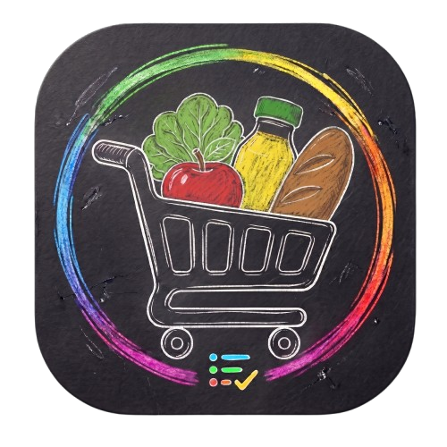

# CARRIN — Sua lista, sem complicação. 🛒

<p align="center">
  
</p>

<p align="center">
  <a href="https://flutter.dev"></a>
  <a href="https://dart.dev"></a>
  <a href="https://developer.android.com"></a>
  <a href="https://github.com/hollopocran/CARRIN/releases"></a>
  <a href="LICENSE"></a>
  <a href="docs/PRIVACY_POLICY.md"></a>
</p>

---

O **CARRIN** é um ecossistema mobile inteligente em Flutter para gestão financeira doméstica, compras de supermercado e economia colaborativa comunitária. O aplicativo une privacidade total com poder analítico:

1. **Privacidade Absoluta & Nuvem Pessoal:** Cada usuário sincroniza suas listas diretamente com sua própria conta do **Google Drive / Google Sheets** via OAuth 2.0 oficial (`UserSheetsService`), sem servidores intermediários ou acesso de terceiros às suas finanças.
2. **Arquitetura Offline-First (SQLite):** Todas as operações (adicionar, riscar, editar, excluir, calcular) funcionam instantaneamente sem sinal de internet no supermercado, com persistência local em SQLite e fila resiliente de sincronização em segundo plano.
3. **Radar de Preços Comunitário (Supabase):** Rede colaborativa de preços em tempo real onde os produtos comprados alimentam uma base comunitária anônima, permitindo comparação de preços por produto, identificação da loja mais barata e economia garantida.
4. **Geolocalização & Catálogo de 3.484 Supermercados:** Mapa geográfico interativo em estilo Google Maps com visualização em satélite, relevo, mapa limpo e noturno, com rotas externas imediatas para Google Maps e Waze.
5. **Scanner Duplo Inteligente:** Leitor de código de barras (EAN-13/8 com preenchimento zero-fricção via histórico e Open Food Facts) e leitor de cupom fiscal (QR Code de NFC-e da SEFAZ com descarte automático de dados do consumidor).
6. **Atualizações Autônomas e Silenciosas (OTA):** Download em segundo plano sem interrupções e aviso compacto pronto para instalar.

---

## ✨ Principais Recursos

* 📱 **Privacidade Total com Google Sheets:** Sincronização direta com a planilha pessoal do seu Google Drive via OAuth 2.0.
* ⚡ **Arquitetura Offline-First (SQLite):** Operações instantâneas mesmo sem internet no subsolo das lojas.
* 💵 **Máscara Monetária Automática (`CurrencyInputFormatter`):** Digitação fluida de valores sem caçar a vírgula.
* 📡 **Radar de Preços Comunitário:** Comparador de preços consolidado por estabelecimento e cálculo de economia.
* 🗺️ **Mapa Geográfico Interativo:** 3.484 supermercados geolocalizados com busca de lojas e traçado de rotas.
* 🧾 **Scanner Duplo (Código de Barras + Cupom Fiscal NFC-e):** Importação em tempo real de produtos e notas fiscais.
* ⚖️ **Calculadora de Peso (Kg) & Assistente Flutuante:** Cálculo de balança de hortifrúti e divisão de conta (*rateio*).
* 🎨 **Personalização & Acessibilidade:** Temas Claro, Escuro e Pastel, modos para daltônicos e controle dinâmico da escala de fontes.
* 📄 **Exportação em PDF:** Relatórios detalhados com layout profissional prontos para envio no WhatsApp.

---

## 🗺️ Arquitetura de Navegação (5 Abas)

1. **Início ([`DashboardScreen`](lib/screens/dashboard_screen.dart)):** Medidor circular de orçamento, grid reordenável de métricas, busca rápida de produtos e atalhos.
2. **Carrinhos ([`MonthSelectionScreen`](lib/screens/month_selection_screen.dart) ➔ [`ShoppingListScreen`](lib/screens/shopping_list_screen.dart)):** Histórico cronológico orgânico de carrinhos, lista interativa, leitores óticos e divisão de conta.
3. **Análises ([`StatisticsScreen`](lib/screens/statistics_screen.dart)):** Gráficos de evolução mensal, gastos por categoria e diagnóstico de perfil de comprador.
4. **Comunidade ([`CommunityRadarScreen`](lib/screens/community_radar_screen.dart)):** Feed comunitário, comparador desduplicado por mercado, ranking regional e mapa interativo ([`MarketMapScreen`](lib/screens/market_map_screen.dart)).
5. **Ajustes ([`SettingsScreen`](lib/screens/settings_screen.dart)):** Paleta de temas, ícone do aplicativo, filtros de acessibilidade visual, backup/restauração do banco SQLite e termos de uso.

---

## 🚀 Como Executar o Projeto

### Pré-requisitos
- [Flutter SDK](https://flutter.dev) instalado (versão `>=3.0.0 <4.0.0`).
- Dispositivo Android conectado via USB (com depuração ativada) ou emulador.

```bash
# 1. Instalar as dependências
flutter pub get

# 2. Executar em modo debug no dispositivo
flutter run

# 3. Compilar APK de Produção (Release)
flutter build apk --release
```

O arquivo gerado fica localizado em `build/app/outputs/flutter-apk/app-release.apk` (e cópias prontas em `apks/`).

---

## 📚 Documentação do Projeto

Toda a documentação técnica, jurídica e de publicação foi organizada na pasta [`docs/`](docs/):

* 📘 [**Documentação Técnica e Arquitetural (DOCUMENTATION.md)**](docs/DOCUMENTATION.md): Diagramas Mermaid detalhados, arquitetura de dados e changelog de versões.
* 🛡️ [**Termos de Uso e Política de Privacidade LGPD (PRIVACY_POLICY.md)**](docs/PRIVACY_POLICY.md): Cláusulas de conformidade integral com a Lei Federal nº 13.709/18.
* 🚀 [**Checklist de Publicação Google Play (PLAY_STORE_CHECKLIST.md)**](docs/PLAY_STORE_CHECKLIST.md): Documentos e checklist para cadastro no Play Console.
* 🔑 [**Guia de Release e Keystore Android (android_release_info.md)**](docs/android_release_info.md): Dados de assinatura, impressões digitais SHA-1/SHA-256 e APIs.

---

## 📄 Licença

Este projeto está sob a licença [MIT](LICENSE) — veja o arquivo [`LICENSE`](LICENSE) para mais detalhes.
